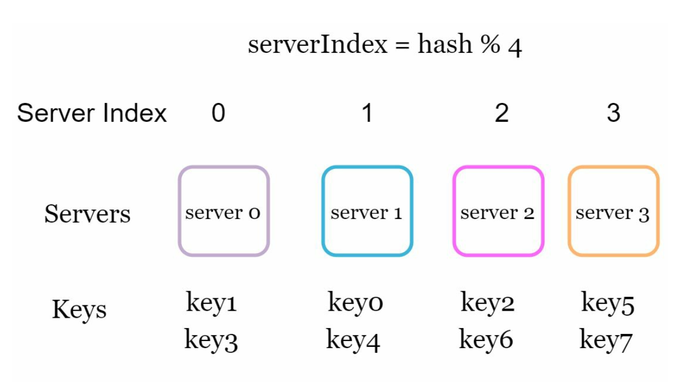
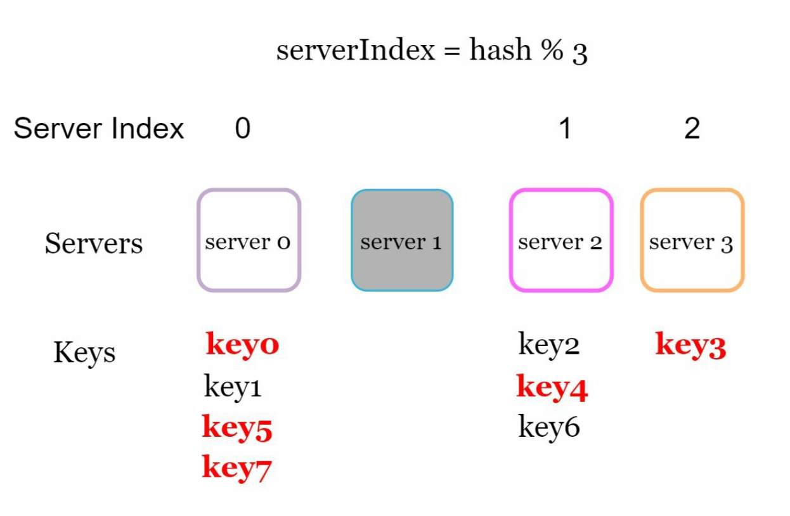
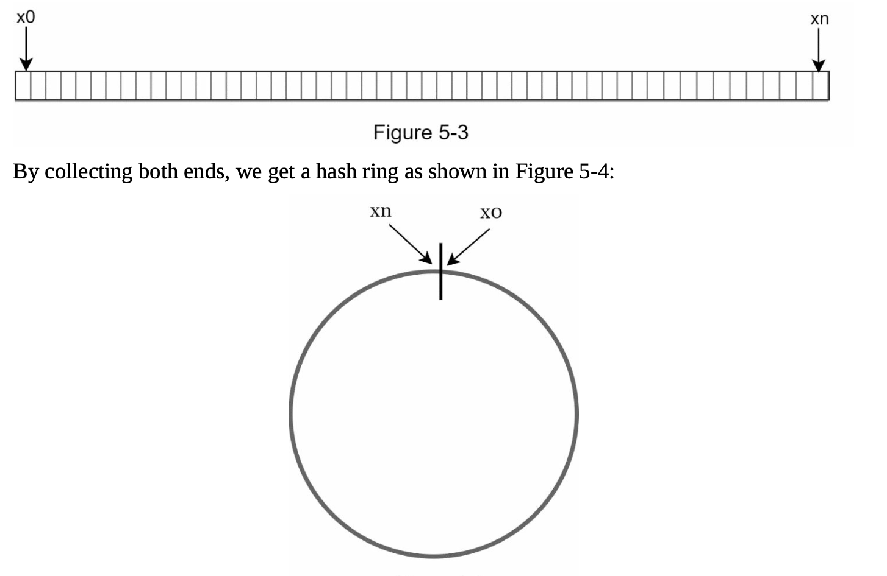
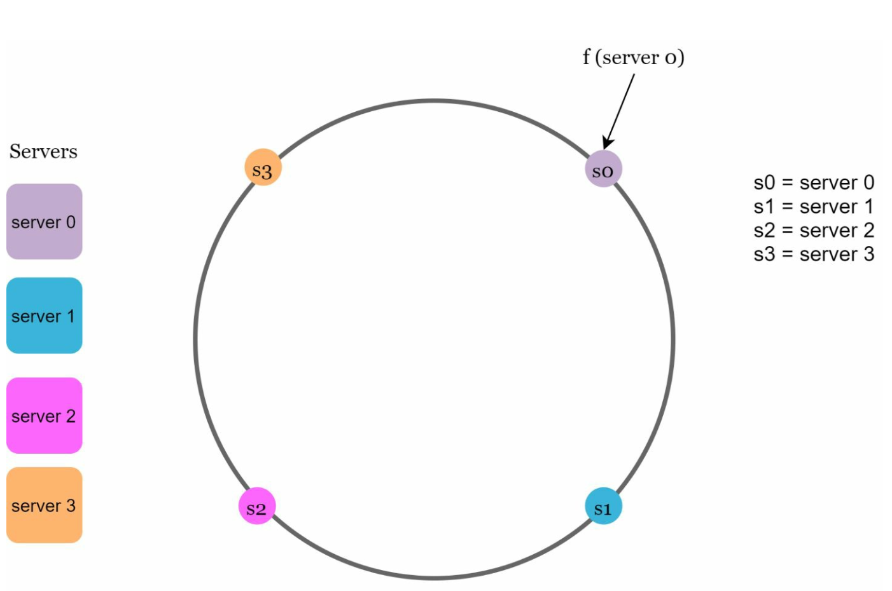
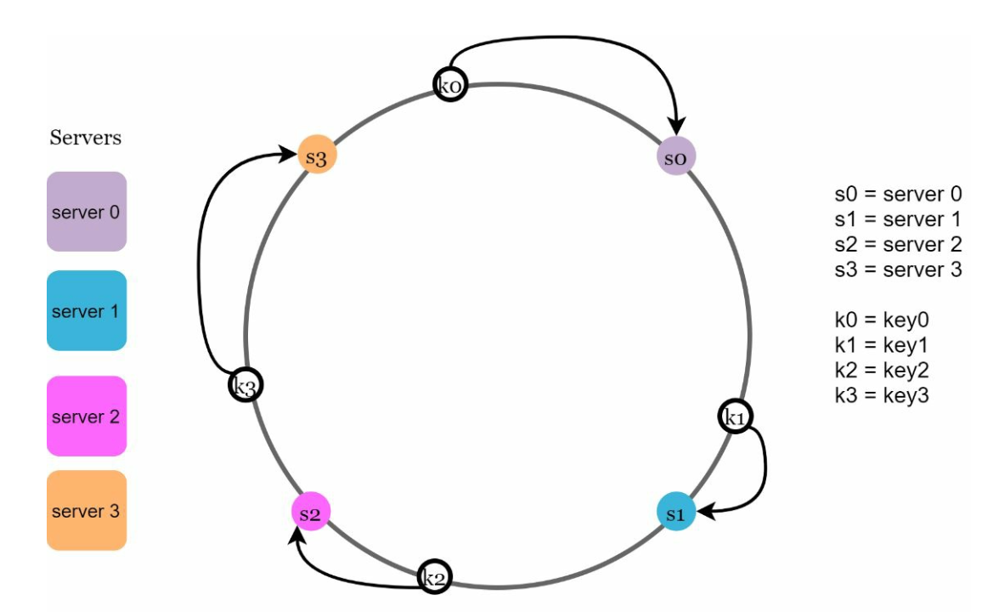
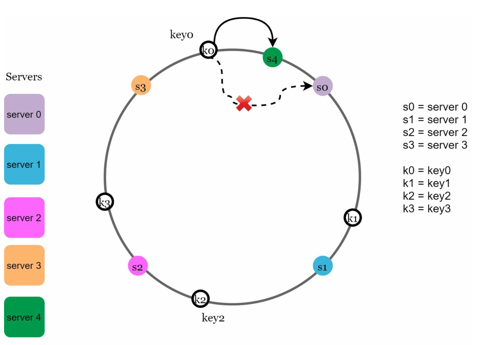
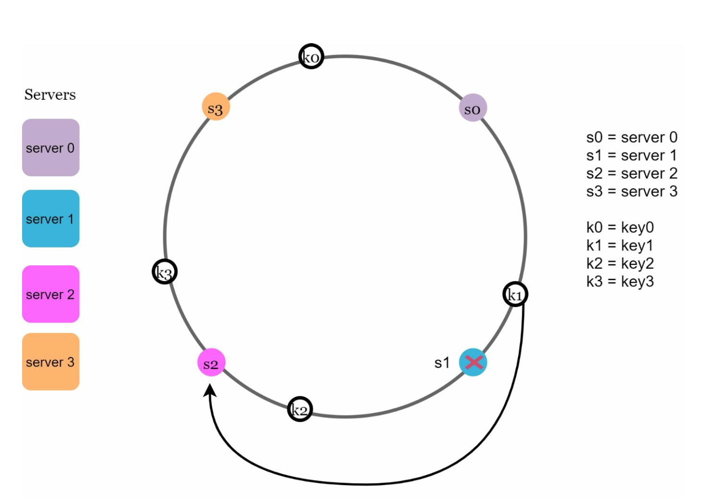
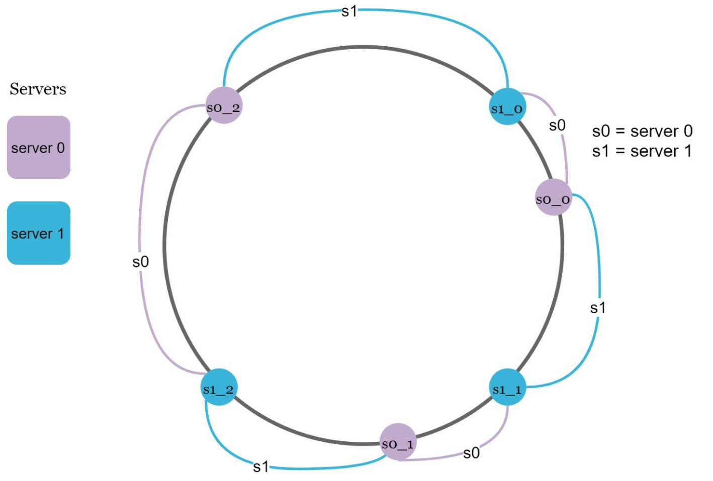

# Chapter 5: Consistent Hashing Design करना (Consistent Hashing)

## Introduction (भूमिका)
इस चैप्टर में हम **Consistent Hashing** के सिद्धांत और डिज़ाइन को गहराई से समझेंगे। Horizontal Scaling को प्रभावी ढंग से लागू करने के लिए Consistent Hashing एक बुनियादी तकनीक है। जब किसी डिस्ट्रीब्यूटेड कैश (जैसे Memcached, Redis Cluster) या डेटाबेस क्लस्टर में डेटा और रिक्वेस्ट्स को कई सर्वर्स में बाँटना होता है, तो Consistent Hashing का उपयोग किया जाता है।

> [!IMPORTANT]
> **मुख्य विचार:**
> Consistent Hashing का मुख्य फायदा यह है कि जब कोई नया सर्वर क्लस्टर में जुड़ता है या क्रैश होता है, तो केवल \(k/n\) कीज़ (keys) को ही री-डिस्ट्रीब्यूट करना पड़ता है, पूरी कैश को खाली नहीं करना पड़ता (जहाँ \(k\) कुल keys की संख्या है और \(n\) कुल सर्वर्स की संख्या है)।

---

## The Rehashing Problem (पारंपरिक हैशिंग की समस्या)

पारंपरिक मॉड्यूलो हैशिंग में जब हमारे पास $N$ कैश सर्वर्स होते हैं, तो किसी की (Key) को सर्वर असाइन करने के लिए हम साधारण फार्मूला लगाते हैं:
$$\text{serverIndex} = \text{hash}(\text{key}) \pmod N$$

  

### यह तरीका कब फेल होता है?
यह तरीका तब तक बहुत अच्छा काम करता है जब तक सर्वर पूल का साइज़ ($N$) फिक्स्ड रहता है। लेकिन डिस्ट्रीब्यूटेड सिस्टम्स में सर्वर्स लगातार scale-out (नए सर्वर जुड़ना) या fail (सर्वर डाउन होना) होते रहते हैं।

  

1. **यदि 1 सर्वर डाउन हो जाए ($N \to N - 1$):**
   - मॉड्यूलो का आधार बदल जाता है। उदाहरण के लिए, $\text{hash}(\text{key}) \pmod 4$ के बजाय अब $\text{hash}(\text{key}) \pmod 3$ होगा।
   - परिणाम यह होता है कि लगभग **सारी कीज़ (Keys)** नए सर्वर इंडेक्स पर मैप हो जाती हैं।
2. **कैश स्टैम्पेड (Massive Cache Miss Storm):**
   - क्लाइंट्स जब भी रिक्वेस्ट भेजेंगे, डेटा नए सर्वर पर मिलेगा नहीं।
   - अचानक सभी रिक्वेस्ट्स सीधे ओरिजिन डेटाबेस पर गिरेंगी, जिससे बैकएंड डेटाबेस ओवरलोड होकर पूरी तरह क्रैश हो सकता है।

---

## Consistent Hashing कैसे काम करता है? (Core Mechanism)

Consistent Hashing यह सुनिश्चित करता है कि जब सर्वर क्लस्टर में बदलाव हो, तो केवल बहुत छोटा हिस्सा ही री-मैप हो, बाकी सारा डेटा अपनी जगह सुरक्षित रहे।

### 1. Hash Space और Hash Ring
हम एक स्टैंडर्ड क्रिप्टोग्राफिक हैश फंक्शन (जैसे SHA-1) चुनते हैं, जिसकी आउटपुट रेंज `0` से `2^160 - 1` होती है।
यदि हम इस हैश स्पेस के दोनों सिरों (`0` और `2^160 - 1`) को आपस में जोड़ दें, तो यह एक गोलाकार वृत्त यानी **Hash Ring** बन जाता है।

  

### 2. सर्वर्स को रिंग पर मैप करना (Server Mapping)
उसी हैश फंक्शन का उपयोग करके, हम सर्वर्स के IP एड्रेस या होस्टनेम (जैसे `10.0.0.1` या `server-node-1`) को रिंग के अलग-अलग बिंदुओं पर मैप करते हैं।

  

### 3. सर्वर लुकअप (Clockwise Traversal)
जब भी किसी कुंजी (Key) को स्टोर या रीड करना होता है:
1. की (Key) का हैश निकाल कर रिंग पर उसकी पोजीशन खोजी जाती है।
2. उस पोजीशन से **घड़ी की दिशा (Clockwise Direction)** में आगे बढ़ा जाता है।
3. रास्ते में जो भी **पहला सर्वर (First Server)** मिलता है, वही सर्वर उस की (Key) को स्टोर करने का जिम्मेदार होता है।

  

---

## सर्वर्स जोड़ना और हटाना (Dynamic Scaling)

### 1. नया सर्वर जोड़ना (Adding a Server)
मान लीजिए क्लस्टर में एक नया सर्वर **$s_4$** जोड़ा गया।
- केवल $s_3$ और $s_4$ के बीच की कीज़ ही नए सर्वर $s_4$ पर री-असाइन होंगी।
- बाकी किसी भी सर्वर (जैसे $s_0, s_1, s_2$) की कीज़ पर कोई प्रभाव नहीं पड़ेगा।

  

### 2. सर्वर हटाना (Removing a Server)
यदि सर्वर $s_1$ अचानक क्रैश हो जाता है:
- केवल $s_1$ पर स्टोर कीज़ ही क्लॉकवाइज अगले सर्वर ($s_2$) पर मूव होंगी।
- बाकी पूरे रिंग का ट्रैफिक अप्रभावित रहेगा।

  

---

## दो बड़ी चुनौतियाँ और उनका समाधान (Virtual Nodes)

बुनियादी Consistent Hashing में 2 मुख्य समस्याएं आती हैं:
1. **Uneven Partition Sizes:** रिंग पर सर्वर्स का विभाजन असमान हो सकता है (एक सर्वर को बहुत बड़ा आर्क मिल जाए और दूसरे को छोटा)।
2. **Non-Uniform Key Distribution (Hotspotting):** किसी एक सर्वर पर बहुत ज्यादा कीज़ चली जाती हैं, जिससे वह हॉटस्पॉट (Hotspot) बनकर ओवरलोड हो जाता है।

### समाधान: Virtual Nodes (Vnodes / आभासी नोड्स)
प्रत्येक फिजिकल सर्वर को रिंग पर केवल 1 बिंदु पर रखने के बजाय, उसे कई **Virtual Nodes** (जैसे 100 या 200 पॉइंट्स) के रूप में रिंग पर फैला दिया जाता है।
उदाहरण के लिए, सर्वर $s_0$ के लिए $s_0\_0, s_0\_1, s_0\_2$ आदि बिंदु बनाए जाते हैं।

  

- **फायदा:** जैसे-जैसे वर्चुअल नोड्स की संख्या बढ़ती है, डेटा का फैलाव (Key Distribution) लगभग एक समान (Uniform) हो जाता है। गणितीय रूप से स्टैंडर्ड डेविएशन (Standard Deviation) बहुत कम हो जाता है, जिससे लोड बैलेंस्ड रहता है।
- **हार्डवेयर क्षमता के अनुसार ट्यूनिंग:** अधिक शक्तिशाली सर्वर को ज्यादा वर्चुअल नोड्स (जैसे 300 Vnodes) और कम शक्तिशाली सर्वर को कम वर्चुअल नोड्स (जैसे 100 Vnodes) दिए जा सकते हैं।

---

## वास्तविक दुनिया में उपयोग (Real-World Applications)
Consistent Hashing उद्योग के सबसे बड़े डिस्ट्रीब्यूटेड सिस्टम्स की रीढ़ है:
- **Amazon DynamoDB & Apache Cassandra:** डेटा पार्टिशनिंग और नोड रेप्लिकेशन के लिए।
- **Discord:** लाखों यूज़र्स के वॉइस और टेक्स्ट चैट्स को रिंग पर बैलेंस करने के लिए।
- **Akamai CDN:** वेब कंटेंट को एज कैशेज में राउट करने के लिए।
- **Google Maglev:** हाई-परफॉर्मेंस नेटवर्क लोड बैलेंसर।
