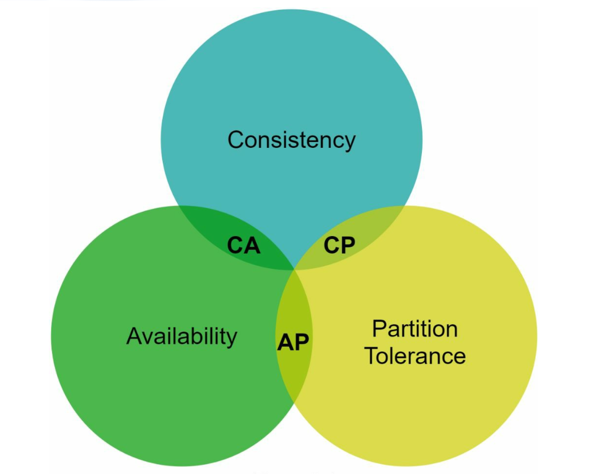
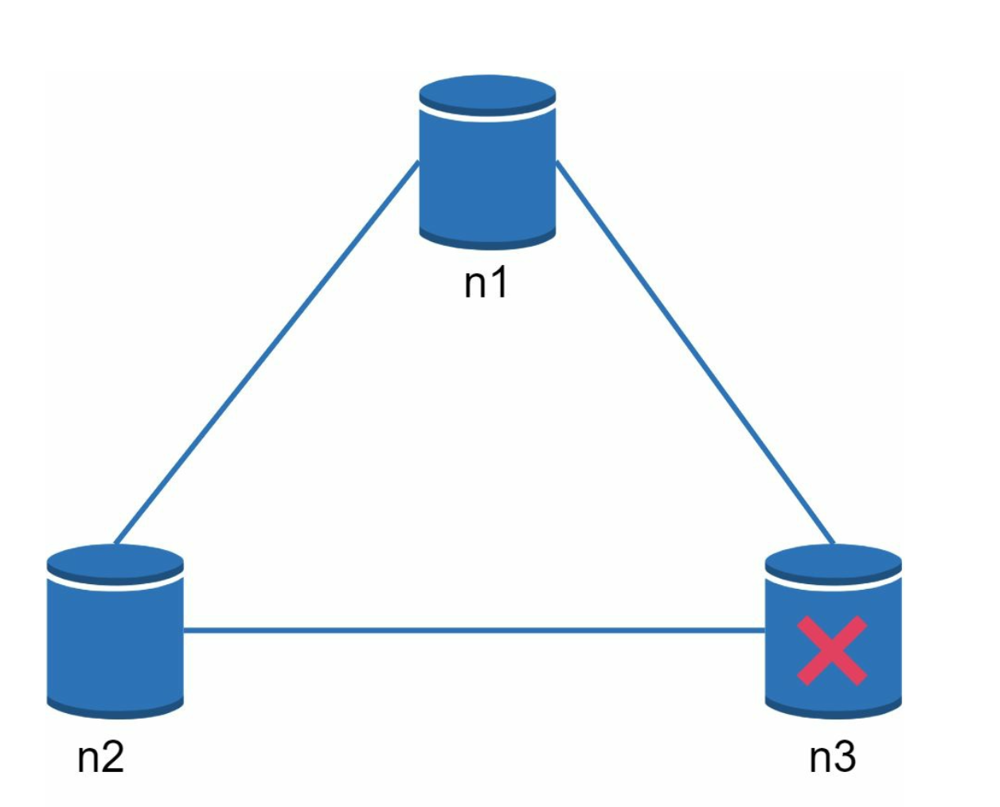
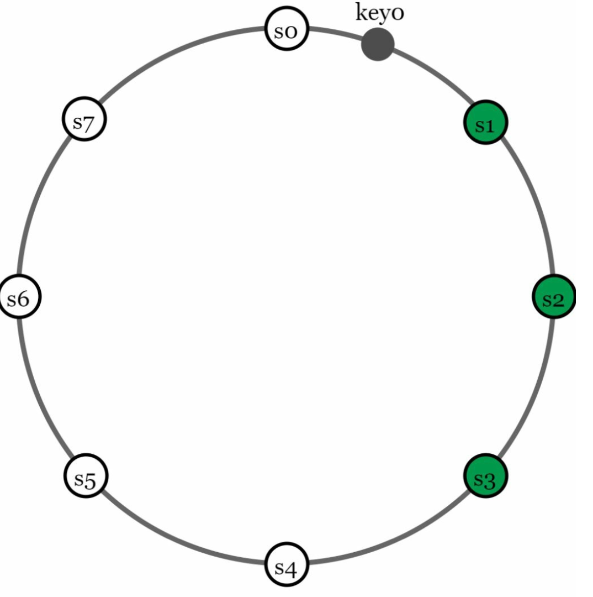
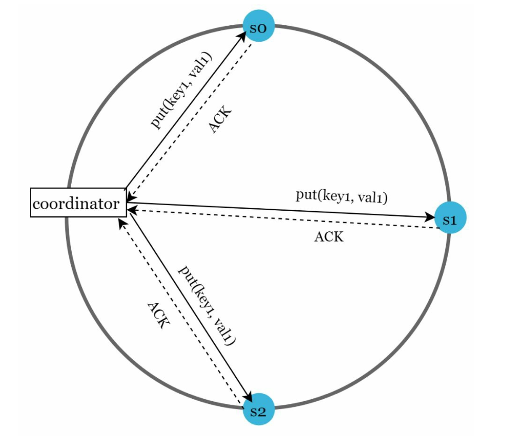
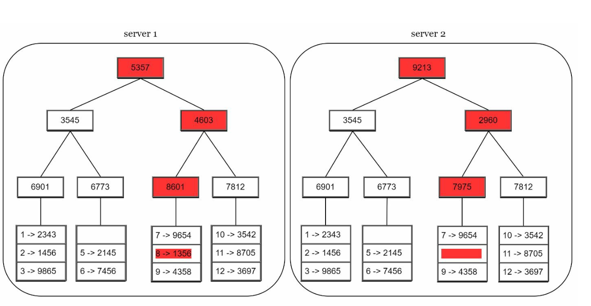
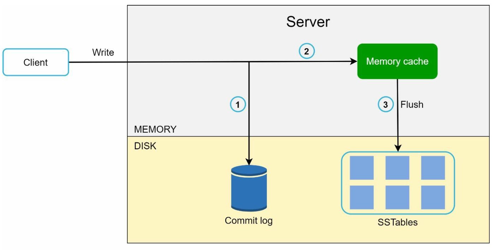
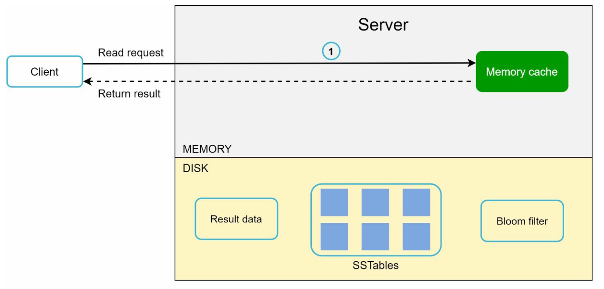
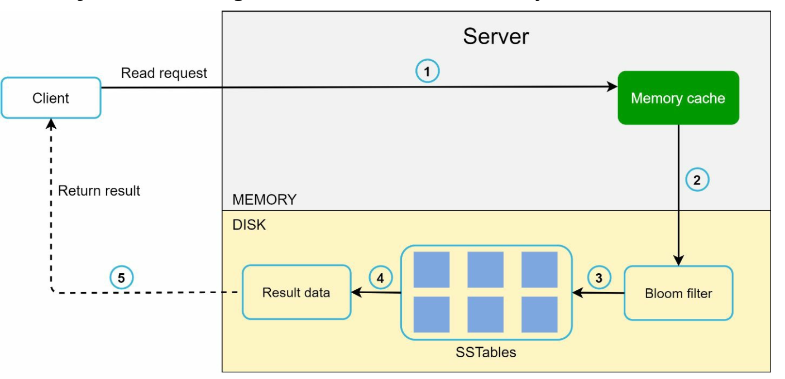
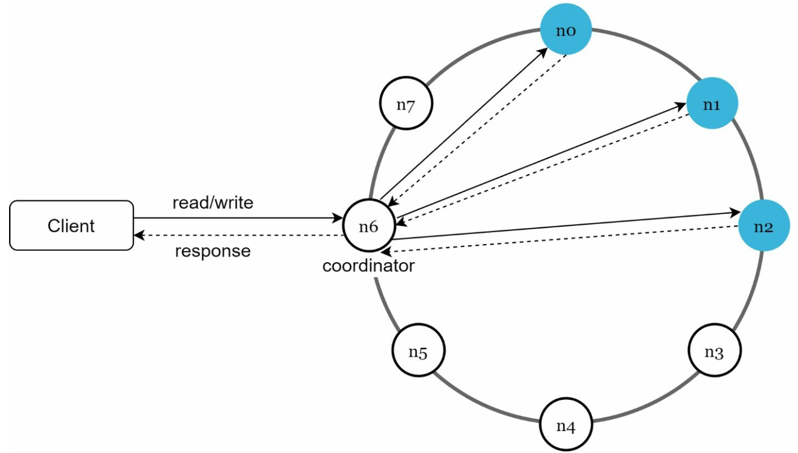

# Chapter 6: Distributed Key-Value Store Design करना (DynamoDB / Cassandra)

## Introduction (भूमिका)
एक **Key-Value Store** (जैसे Amazon DynamoDB, Apache Cassandra, या Redis) एक नो-एसक्यूएल (NoSQL) डेटाबेस होता है जहाँ डेटा की-वैल्यू पेयर्स (`key -> value`) के रूप में स्टोर किया जाता है। 

इस चैप्टर में हम एक अत्यधिक स्केलेबल, फॉल्ट-टॉलरेंट और हाई-अवेलेबिलिटी वाला **Distributed Key-Value Store** डिज़ाइन करेंगे जो दो मुख्य ऑपरेशन्स सपोर्ट करता है:
- `put(key, value)`: डेटा इंसर्ट या अपडेट करना।
- `get(key)`: डेटा रिट्रीव करना।

### मुख्य आवश्यकताएं (Requirements)
- **High Availability & Scalability:** पेटाबाइट्स (PB) डेटा और करोड़ों QPS को सपोर्ट करना।
- **Tunable Consistency:** यूज़र अपनी जरूरत के अनुसार स्ट्रॉन्ग या इवेन्चुअल कंसिस्टेंसी चुन सके।
- **Low Latency:** सब-मिलीसेकंड रीड और राइट ऑपरेशन्स।

---

## CAP Theorem और ट्रेड-ऑफ्स (CAP Theorem Trade-Offs)

डिस्ट्रीब्यूटेड सिस्टम्स में **CAP Theorem** बुनियादी नियम तय करता है:

1. **Consistency (संगति):** क्लस्टर के सभी नोड्स पर एक ही समय में सभी क्लाइंट्स को समान और सबसे ताज़ा डेटा दिखता है।
2. **Availability (उपलब्धता):** क्लस्टर का कोई भी नोड क्रैश होने पर भी हर गैर-विफल नोड से रिस्पॉन्स मिलना अनिवार्य है।
3. **Partition Tolerance (नेटवर्क पार्टिशन सहनशीलता):** जब दो डेटा सेंटर्स या नोड्स के बीच नेटवर्क केबल्स कट जाएं या पैकेट्स ड्रॉप हों, तब भी सिस्टम काम करता रहे।

  

> [!IMPORTANT]
> **कठोर सत्य:** 
> चूंकि वास्तविक दुनिया में नेटवर्क केबल्स कटने और राउटर फेल होने से बचा नहीं जा सकता, इसलिए **Partition Tolerance (P) अनिवार्य है**। इसका मतलब है कि असल दुनिया में केवल दो ही तरह के सिस्टम्स संभव हैं:
> - **CP Systems (Consistency + Partition Tolerance):** बैंकिंग सिस्टम्स की तरह, जहाँ अगर नोड्स आपस में बात नहीं कर पा रहे तो राइट्स को ब्लॉक कर दिया जाएगा (Availability का त्याग) ताकि गलत बैलेंस न लिखा जाए।
> - **AP Systems (Availability + Partition Tolerance):** सोशल मीडिया या शॉपिंग कार्ट की तरह, जहाँ सिस्टम हमेशा रिक्वेस्ट एक्सेप्ट करेगा (Eventual Consistency), और नेटवर्क ठीक होने पर डेटा बाद में सिंक कर लिया जाएगा।
> 
> *अतः शुद्ध CA सिस्टम डिस्ट्रीब्यूटेड वातावरण में असंभव है।*

  

---

## सिस्टम के 5 मुख्य कंपोनेंट्स (Core Architectural Components)

### 1. Data Partitioning (डेटा विभाजन - Consistent Hashing)
डेटा को दर्जनों सर्वर्स में समान रूप से बांटने के लिए हम **Consistent Hashing with Virtual Nodes** का उपयोग करते हैं:
- जब भी कोई नया सर्वर जुड़ता है या हटता है, तो केवल \(k/n\) डेटा ही माइग्रेट होता है।
- अधिक शक्तिशाली सर्वर को ज्यादा Virtual Nodes दिए जाते हैं।

---

### 2. Data Replication (डेटा रेप्लिकेशन)
हाई अवेलेबिलिटी के लिए डेटा को रिंग पर क्लॉकवाइज आगे बढ़ते हुए अगले **$N$ अलग-अलग फिजिकल सर्वर्स** पर रेप्लिकेट किया जाता है। आपदा से बचने के लिए इन रेप्लिकाज़ को अलग-अलग डेटा सेंटर्स (Availability Zones) में रखा जाता है।

  

---

### 3. Quorum Consensus (कंसिस्टेंसी ट्यूनिंग)
$N$ रेप्लिकाज़ के बीच कंसिस्टेंसी को ट्यून करने के लिए हम कोरम सर्वसम्मति (Quorum) का उपयोग करते हैं:
- **$N$:** कुल रेप्लिकाज़ की संख्या (उदा. $N = 3$).
- **$W$:** Write Quorum (राइट को सफल मानने के लिए कम से कम कितने नोड्स से ACK मिलना जरूरी है).
- **$R$:** Read Quorum (रीड को सफल मानने के लिए कम से कम कितने नोड्स से डेटा पढ़ना जरूरी है).

  

> [!TIP]
> **The Quorum Rule:**
> - यदि **$W + R > N$** है, तो **Strong Consistency** की गारंटी होती है (क्योंकि रीड और राइट कोरम में कम से कम 1 नोड हमेशा ओवरलैप होगा जो सबसे ताज़ा डेटा जानता है)। आमतौर पर: $N = 3, W = 2, R = 2$.
> - यदि तेज़ रीड चाहिए: $R = 1, W = N$.
> - यदि तेज़ राइट चाहिए: $W = 1, R = N$.

---

### 4. Vector Clocks (कॉन्फ्लिक्ट रेजोल्यूशन)
जब नेटवर्क पार्टिशन के दौरान दो अलग-अलग सर्वर्स पर एक ही की (Key) के दो अलग वर्शन्स लिख दिए जाते हैं, तो कॉन्फ्लिक्ट पैदा होता है।
- **Vector Clock** एक `[Server_ID, Version_Counter]` पेयर होता है:
  $$D([S_1, v_1], [S_2, v_2], \dots)$$
- इससे सिस्टम यह पहचान पाता है कि कौन सा वर्शन किसका पूर्वज (Ancestor) है और कब दो वर्शन्स के बीच समवर्ती टकराव (Concurrent Sibling Conflict) हुआ है जिसे क्लाइंट या ऐप को मर्ज करना होगा।

---

### 5. Failure Detection और Handling

#### a. Gossip Protocol (विफलता का पता लगाना)
सेंट्रल मॉनिटरिंग के बजाय नोड्स आपस में रैंडमली एक दूसरे को गॉसिप मैसेजेस भेजते हैं और हार्टबीट काउंटर्स बढ़ाते हैं। यदि किसी नोड का हार्टबीट लंबे समय तक नहीं बढ़ता, तो उसे सर्वसम्मति से 'Dead' घोषित कर दिया जाता है।

#### b. Sloppy Quorum और Hinted Handoff (अस्थायी विफलता)
यदि नोड $A$ अस्थायी रूप से डाउन है, तो रिंग पर मौजूद दूसरा स्वस्थ नोड उसकी जगह राइट एक्सेप्ट कर लेता है और उस पर "Hint" लगा देता है। जैसे ही नोड $A$ दोबारा ऑनलाइन आता है, डेटा उसे सौंप दिया जाता है (**Hinted Handoff**)।

#### c. Merkle Trees (स्थायी विफलता - Anti-Entropy)
डेटाबेस रेप्लिकाज़ के बीच असंगतियों (Inconsistencies) को तेज़ी से खोजने के लिए **Merkle Tree (Hash Tree)** का उपयोग किया जाता है।
- केवल रूट हैश (Root Hash) की तुलना करके पता चल जाता है कि डेटा मैच है या नहीं।
- यदि हैश अलग है, तो केवल मिसमैच वाली शाखा (Branch) का डेटा ही नेटवर्क पर ट्रांसफर किया जाता है, जिससे बैंडविड्थ की भारी बचत होती है।

  

---

## Write Path और Read Path (Cassandra Engine का आंतरिक रहस्य)

### 1. Write Path (अल्ट्रा-फास्ट राइट्स)

    

1. डेटा सबसे पहले डिस्क पर मौजूद **Commit Log** में सीक्वेंशियली लिखा जाता है (क्रैश रिकवरी के लिए)।
2. इसके बाद डेटा इन-मेमोरी बफर यानी **MemTable** में लिखा जाता है।
3. क्लाइंट को तुरंत "SUCCESS" रिस्पॉन्स लौटा दिया जाता है! (यह सब 1 मिलीसेकंड से भी कम में होता है क्योंकि कोई रैंडम डिस्क I/O नहीं हुआ)।
4. जब MemTable भर जाती है, तो बैकग्राउंड में डेटा डिस्क पर **SSTable (Sorted String Table)** के रूप में फ्लश हो जाता है।

---

### 2. Read Path (ब्लूम फिल्टर के साथ)

    
    

1. सबसे पहले चेक किया जाता है कि क्या डेटा **MemTable** (RAM) में है। यदि हाँ, तुरंत रिटर्न।
2. यदि RAM में नहीं है, तो डिस्क पर सैकड़ों SSTables में खोजना बहुत धीमा हो सकता है।
3. इसलिए सिस्टम **Bloom Filter** का उपयोग करता है:
   - Bloom Filter एक अत्यंत तेज़ स्पेस-एफिशिएंट डेटा स्ट्रक्चर है जो 100% निश्चितता के साथ बता देता है कि: *"यह Key इस SSTable फाइल में बिल्कुल नहीं है"*।
4. इससे गैर-ज़रूरी डिस्क I/O पूरी तरह बच जाता है, और सिस्टम केवल उसी सटीक SSTable को पढ़ता है जहाँ डेटा मौजूद है।

---

## सम्पूर्ण आर्किटेक्चर सारांश (Final Architecture)

- **Coordinator Node:** क्लाइंट के लिए प्रॉक्सी का काम करता है।
- **Consistent Hash Ring:** डेटा को डीसेंट्रलाइज़्ड तरीके से पार्टिशन करता है।
- **Zero Single Point of Failure:** सभी नोड्स समान अधिकार और ज़िम्मेदारी रखते हैं (Masterless Peer-to-Peer Architecture)।
