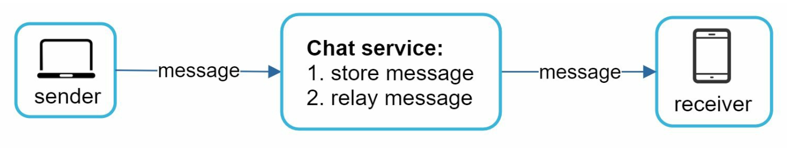
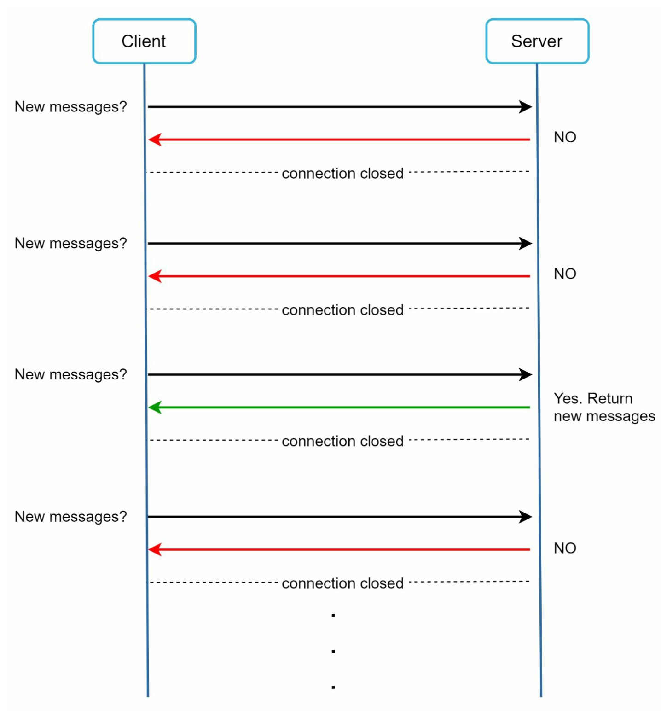
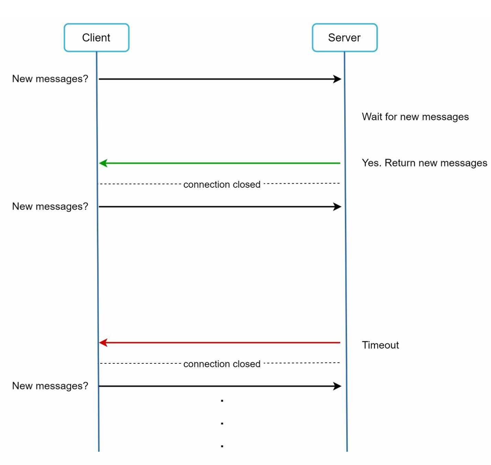
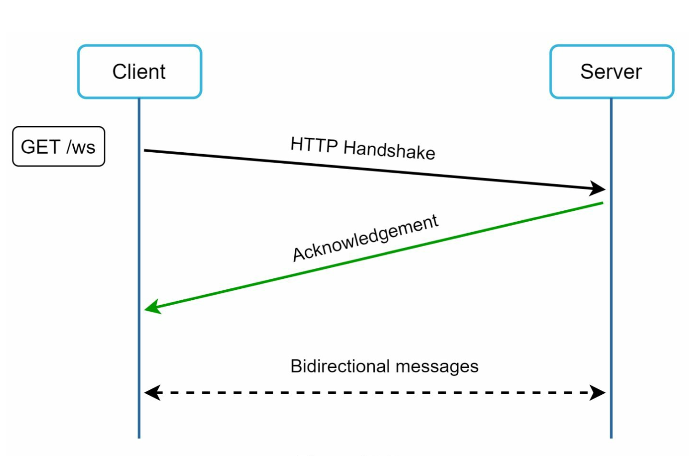
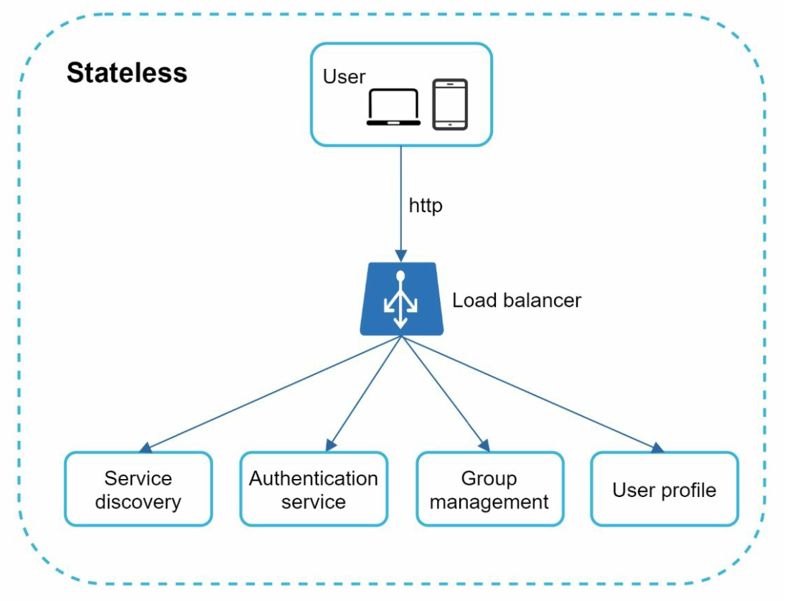
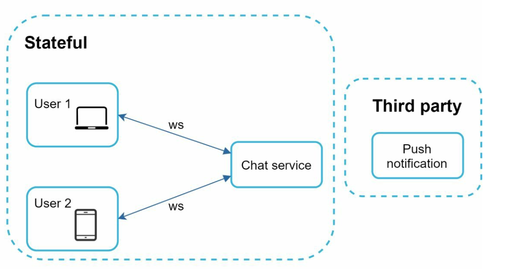
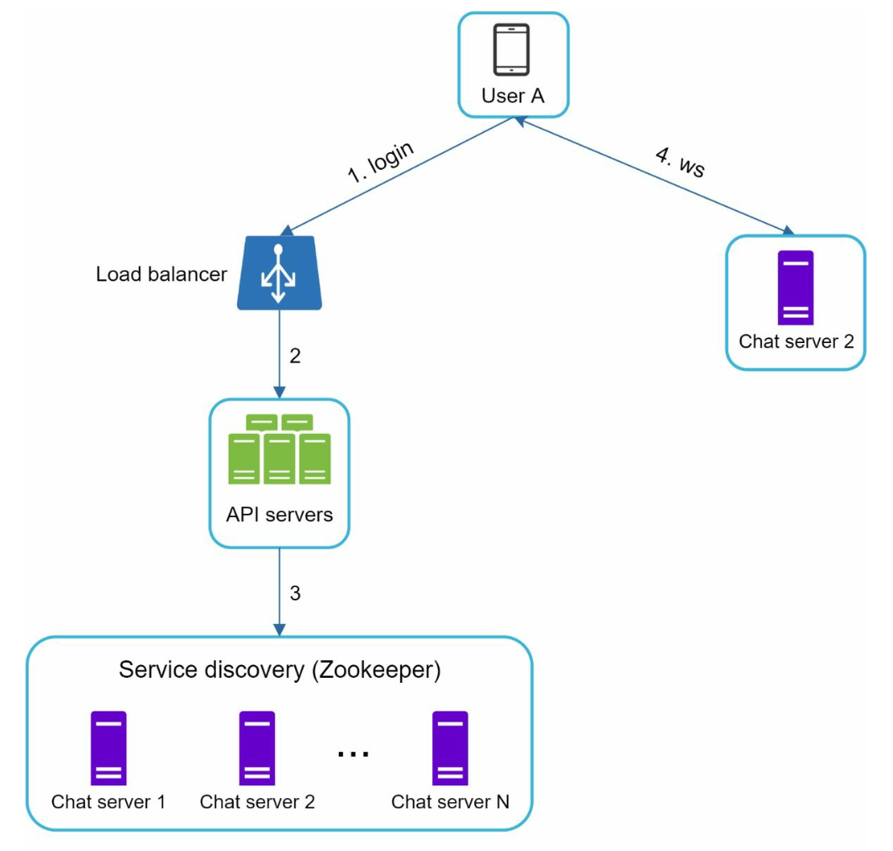
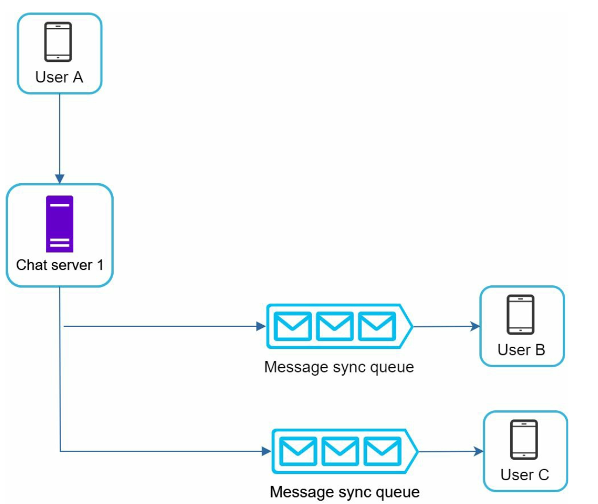
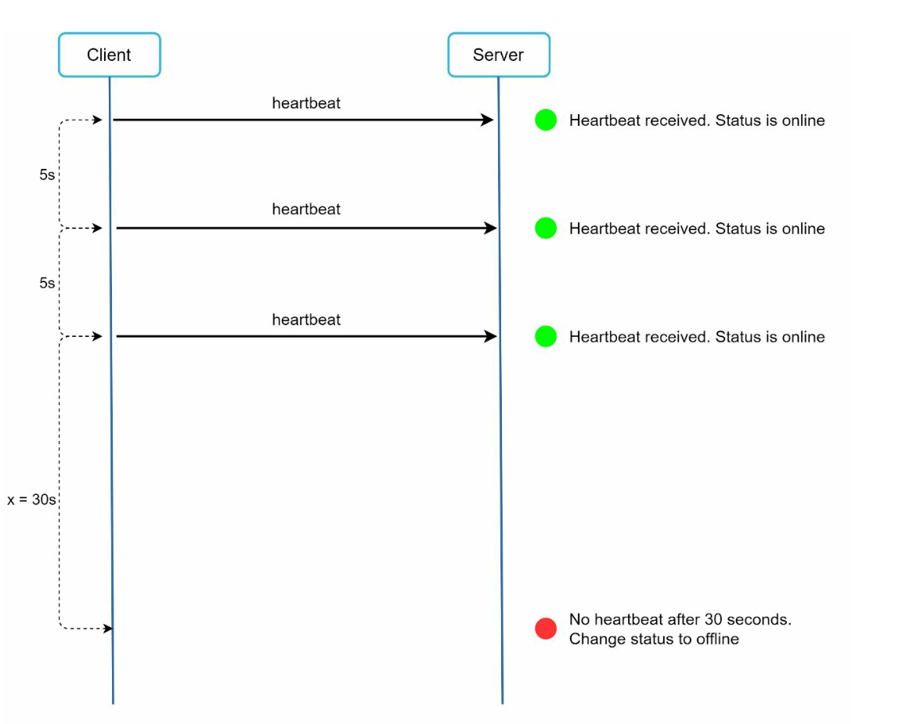
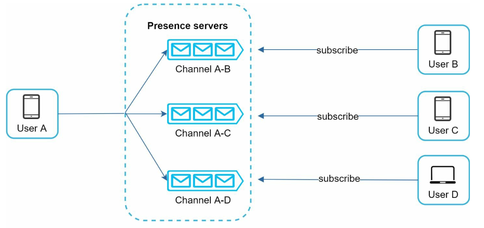

# Chapter 12: Real-time Chat System Design करना (WhatsApp / Discord / Messenger)

## Introduction (भूमिका)
एक **Real-time Chat System** (जैसे WhatsApp, Discord, Slack, या WeChat) यूज़र्स के बीच तुरंत संदेशों के आदान-प्रदान की सुविधा देता है। 

इस चैप्टर में हम एक ऐसा चैट सिस्टम डिज़ाइन करेंगे जो:
- **One-on-One Chat:** दो यूज़र्स के बीच सीधी बातचीत।
- **Group Chat:** 100 सदस्यों तक के ग्रुप चैट्स।
- **Online Presence:** यह दिखाना कि कौन सा दोस्त अभी ऑनलाइन या ऑफलाइन है।
- **Multi-Device Sync:** एक ही यूज़र के फोन, लैपटॉप और टैबलेट पर चैट का सिंक रहना।
- **Push Notifications:** जब यूज़र ऑफलाइन हो तो नोटिफिकेशन भेजना।
- **Scale:** **50 Million Daily Active Users (DAU)**.

---

## Step 1: Communication Protocols (प्रोटोकॉल का चुनाव)

पारंपरिक HTTP एक Request-Response प्रोटोकॉल है, जहाँ केवल क्लाइंट रिक्वेस्ट शुरू कर सकता है, सर्वर खुद से क्लाइंट को डेटा नहीं भेज सकता।

### 1. Polling (धीमा और अप्रभावी)

- क्लाइंट हर 1 सेकंड में सर्वर से पूछता है: *"क्या कोई नया मैसेज है?"*
- 99% कॉल्स खाली लौटती हैं, जिससे सर्वर के CPU और नेटवर्क बैंडविड्थ की भारी बर्बादी होती है।

### 2. Long Polling (कामचलाऊ)

- क्लाइंट कनेक्शन खोलता है और सर्वर तब तक होल्ड रखता है जब तक नया मैसेज न आ जाए या टाइमआउट न हो जाए।
- लगातार डिस्कनेक्ट और री-कनेक्ट होने से ओवरहेड बढ़ता है।

### 3. The Winner: WebSockets (उद्योग मानक)

- **WebSocket Protocol (`ws://` या `wss://`):** 
  - एक बार HTTP हैंडशेक होने के बाद क्लाइंट और चैट सर्वर के बीच एक **स्थायी, द्वि-दिशात्मक (Persistent Bi-directional Full-Duplex)** TCP कनेक्शन बन जाता है।
  - सर्वर बिना किसी लेटेंसी के तुरंत क्लाइंट को नया मैसेज पुश कर सकता है।

---

## Step 2: High-Level Architecture (स्टेटलेस vs स्टेटफुल टियर)

       
   

### 1. Stateless Services (पारंपरिक HTTP APIs)
- लॉगिन, साइनअप, यूज़र प्रोफाइल और सेटिंग्स के लिए। इन्हें लोड बैलेंसर के पीछे हॉरिजॉन्टली स्केल किया जा सकता है।

### 2. Stateful Services (WebSocket Chat Servers)
- चैट सर्वर्स लाखों एक्टिव यूज़र्स के खुले हुए TCP WebSockets होल्ड करते हैं।
- **Service Discovery (Apache ZooKeeper):** जब यूज़र ऐप खोलता है, तो ज़ूकीपर यूज़र के सबसे करीबी और सबसे कम लोड वाले चैट सर्वर का पता देता है।

      

---

## Step 3: चैट हिस्ट्री के लिए डेटाबेस का चुनाव (NoSQL Key-Value Store)

चैट सिस्टम में रोज़ाना अरबों मैसेजेस बनते हैं। 
- **Relational DB (MySQL) अनुपयुक्त है:** जब टेबल में 10 अरब से ज्यादा पंक्तियां होती हैं, तो B-Tree इंडेक्स बहुत बड़ा हो जाता है और रैंडम I/O बहुत धीमा हो जाता है।
- **Key-Value NoSQL Store (जैसे Apache Cassandra / HBase):**
  - **Sequential Writes:** डिस्क पर सीक्वेंशियल राइट्स (SSTables) बहुत तेज़ होते हैं।
  - **Horizontal Sharding:** पेटाबाइट्स डेटा को नोड्स में आसानी से बांटा जा सकता है।
  - Facebook Messenger और Discord दोनों Cassandra / ScyllaDB का उपयोग करते हैं।

### Data Schema (प्राइमरी की स्ट्रक्चर):
- **1-on-1 Chat Table:**
  - Primary Key: `(channel_id, message_id)`
  - `message_id` को **Snowflake ID** से जनरेट किया जाता है ताकि मैसेजेस हमेशा समय के अनुसार क्रमबद्ध (Time-Sorted) रहें।

---

## Step 4: Messaging Flows (संदेश भेजने और पाने का प्रवाह)

### 1. 1-on-1 Chat Flow
1. User A अपने चैट सर्वर 1 को WebSocket के ज़रिए मैसेज भेजता है।
2. चैट सर्वर 1 मैसेज को Cassandra में लिखता है।
3. चैट सर्वर 1 यह पता लगाता है कि User B किस चैट सर्वर से जुड़ा है।
4. यदि User B ऑनलाइन है: मैसेज सीधे User B के चैट सर्वर 2 को फॉरवर्ड होता है और उसकी स्क्रीन पर पॉप हो जाता है।
5. यदि User B ऑफलाइन है: **Push Notification Service** को अलर्ट भेजा जाता है।

### 2. Group Chat Flow (छोटा ग्रुप $\le$ 100 सदस्य)

     

- जब कोई सदस्य ग्रुप में मैसेज भेजता है, तो मैसेज उस ग्रुप के सभी अन्य 99 सदस्यों के व्यक्तिगत इनबॉक्स (Message Sync Queue) में कॉपी कर दिया जाता है।
- इससे हर सदस्य का इनबॉक्स स्वतंत्र और तेज़ रहता है।

---

## Step 5: Online Presence & Heartbeat (ऑनलाइन/ऑफलाइन स्टेटस)

    

यदि मोबाइल फोन की बैटरी खत्म हो जाए या टनल में नेटवर्क चला जाए, तो TCP FIN पैकेट नहीं भेजा जाता। सर्वर को कैसे पता चले कि यूज़र ऑफलाइन हो गया है?
- **Heartbeat Mechanism:** क्लाइंट हर 5 सेकंड में एक छोटा पिंग (`heartbeat`) प्रेजेंस सर्वर को भेजता है।
- यदि प्रेजेंस सर्वर को **30 सेकंड** तक कोई हार्टबीट नहीं मिलती, तो वह यूज़र का स्टेटस Redis में `offline` सेट कर देता है।

    

- **Presence Fanout (Pub/Sub):** जब किसी दोस्त का स्टेटस बदलता है, तो Redis Pub/Sub के जरिए उसके सभी ऑनलाइन दोस्तों के चैट सर्वर्स को नोटिफिकेशन पुश कर दिया जाता है।

