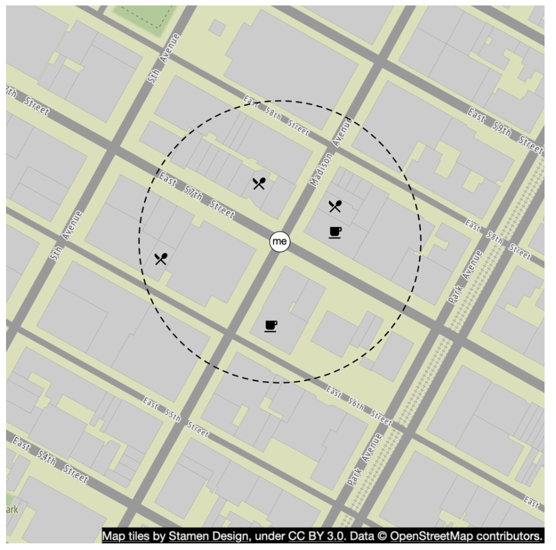
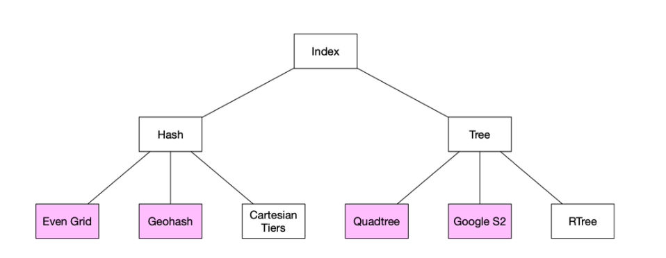
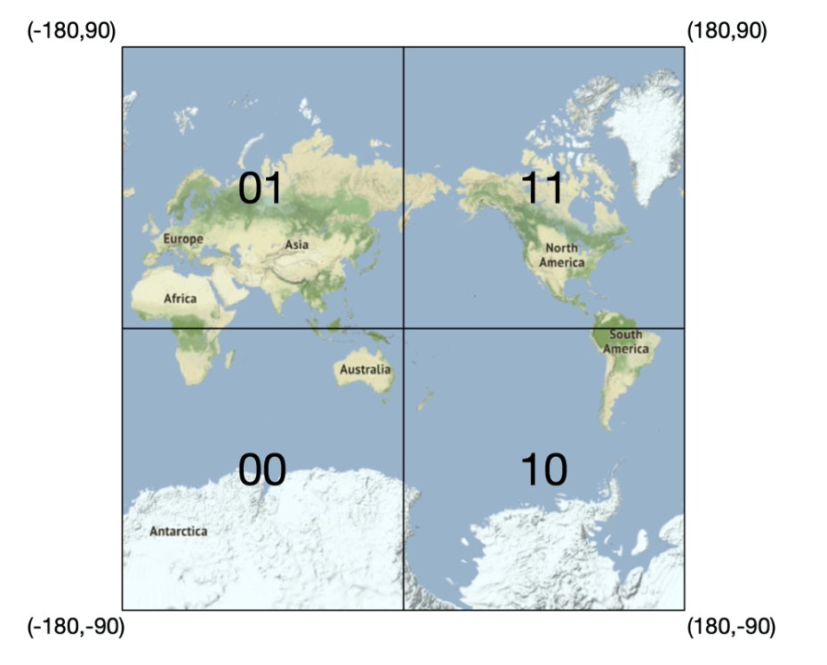
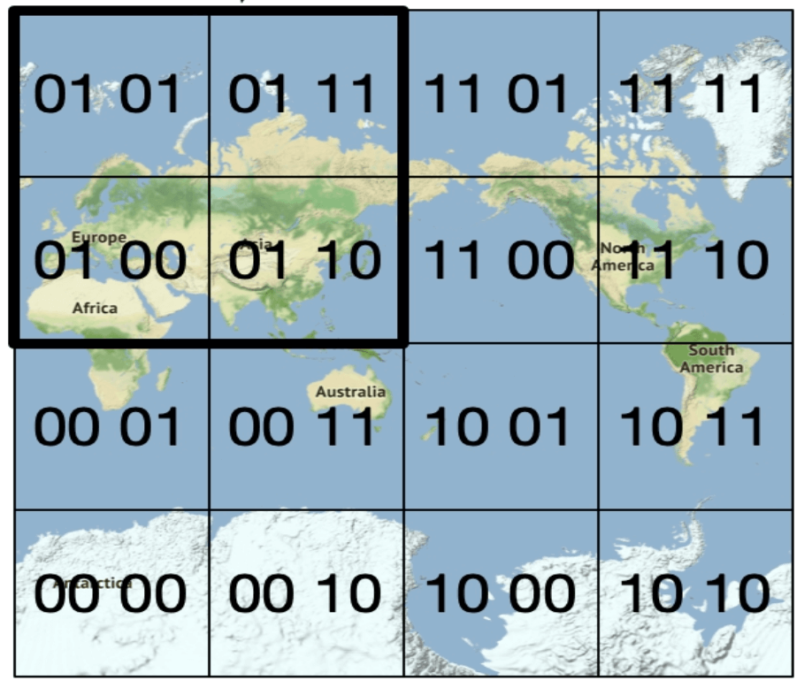
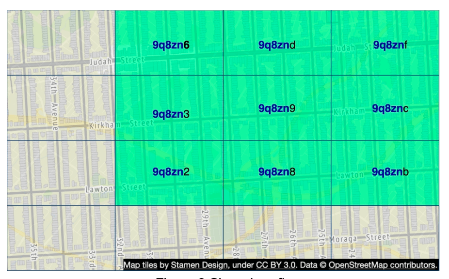
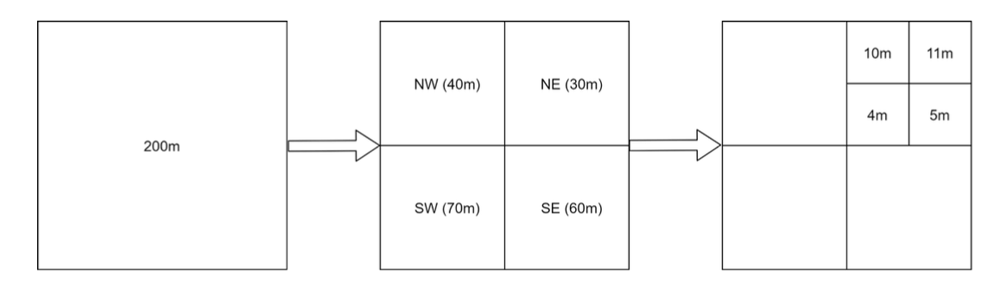
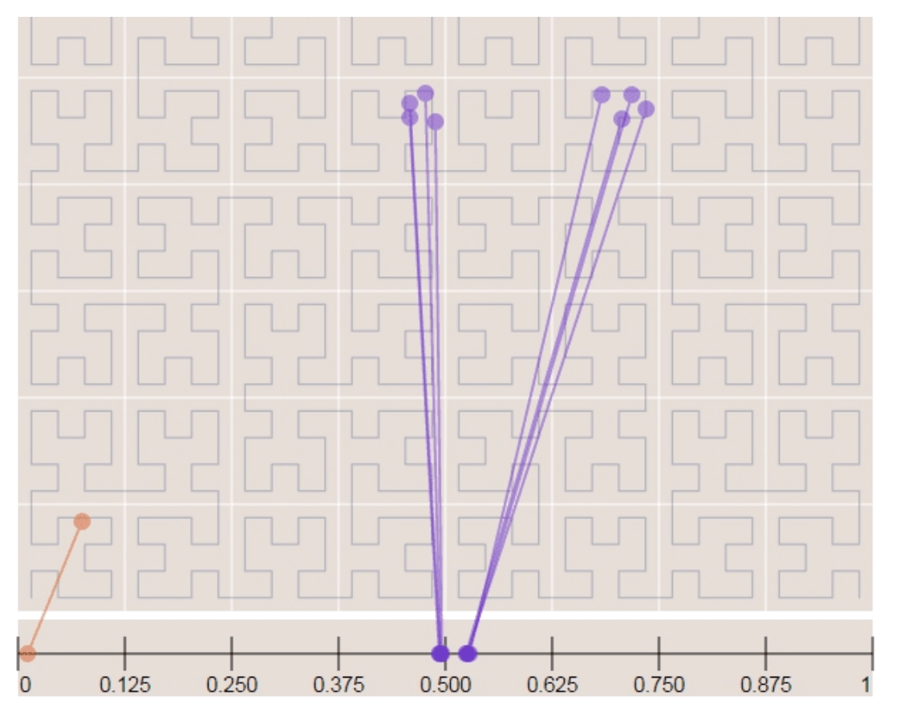
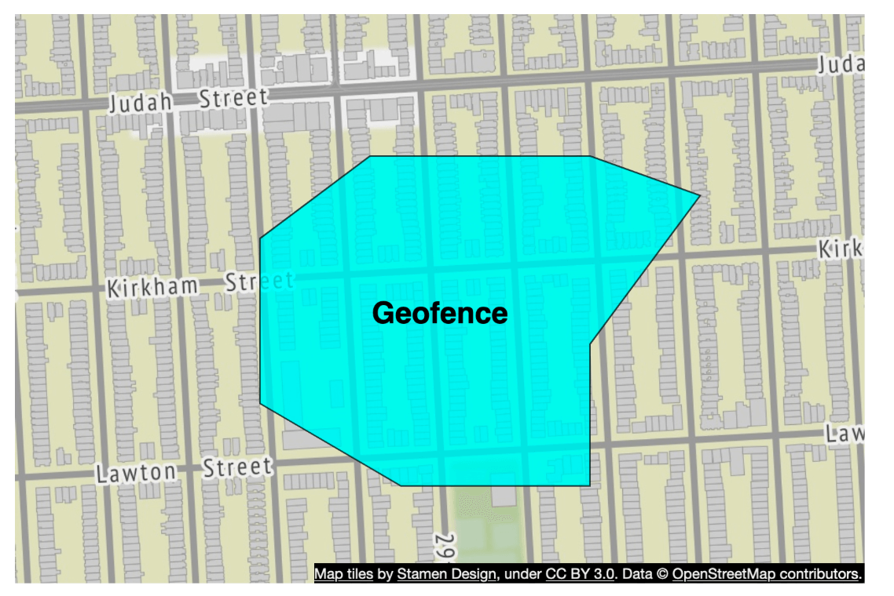
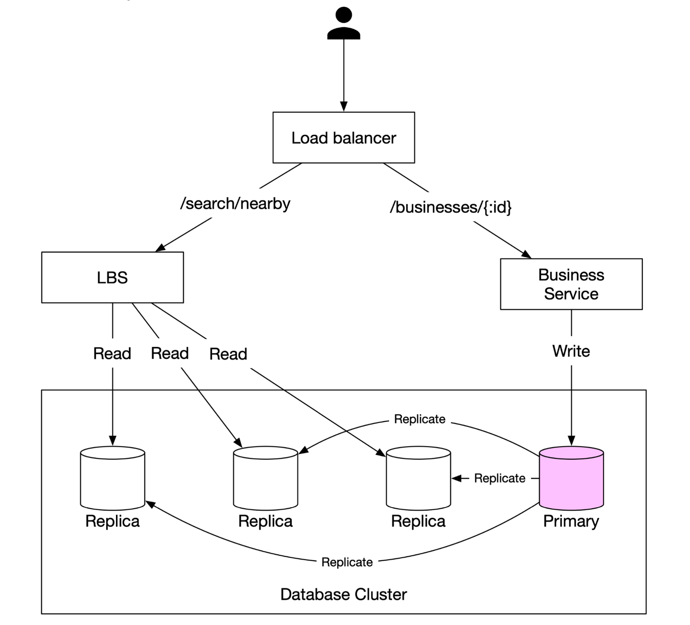

# Chapter 16: Proximity Service Design करना (Yelp / Google Maps Nearby Search)

## Introduction (भूमिका)
एक **Proximity Service** (जैसे Yelp, Zomato, Google Maps Nearby, या Uber Driver Locator) यूज़र की वर्तमान लोकेशन (Latitude, Longitude) के आधार पर उसके आस-पास मौजूद चुनिंदा स्थानों (जैसे 5 किमी के दायरे में रेस्तरां, पेट्रोल पंप, एटीएम) को तेज़ी से खोजने का काम करती है।

### सिस्टम की मुख्य आवश्यकताएं (Requirements)
- **Search Nearby:** यूज़र के दिए गए रेडियस (जैसे 5 km) के अंदर व्यवसायों (Businesses) को खोजना।
- **Low Latency:** खोज परिणाम 100 मिलीसेकंड से भी कम में स्क्रीन पर लोड होने चाहिए।
- **Scale:** **100 Million Daily Active Users**, 200 Million ग्लोबल बिज़नेसेज, और $\approx \mathbf{5,000\text{ Search QPS}}$।

---

## Step 1: 2D Geospatial Search की समस्या (Naive Approach क्यों फेल होता है?)

<div style="margin-left:3rem">
    
</div>

यदि हम साधारण SQL क्वेरी चलाएं:
```sql
SELECT business_id, latitude, longitude
FROM business
WHERE (latitude BETWEEN :lat - 0.05 AND :lat + 0.05)
  AND (longitude BETWEEN :long - 0.05 AND :long + 0.05);
```
- **बड़ी समस्या:** रिलेशनल डेटाबेस का स्टैंडर्ड B-Tree इंडेक्स केवल **1 डाइमेंशन (1D)** पर काम करता है। यदि आप `latitude` पर इंडेक्स बनाते हैं, तो वह केवल अक्षांश फ़िल्टर करेगा, और फिर लाखों रिकॉर्ड्स पर देशांतर (`longitude`) का फुल टेबल स्कैन करना पड़ेगा!
- **समाधान:** 2-D पृथ्वी की सतह (Latitude + Longitude) को **1-D स्ट्रिंग या नंबर** में बदलना (Geospatial Indexing)।

---

## Step 2: Top Geospatial Indexing Algorithms

<div style="margin-left:3rem">
    
</div>

### 1. Geohash (उद्योग मानक - सबसे लोकप्रिय)
<div style="margin-left:3rem">
    
    
</div>

- **कार्यप्रणाली:** पृथ्वी को ग्रीनविच मेरिडियन और भूमध्य रेखा (Equator) से 4 क्वाड्रेंट्स में बांटा जाता है। फिर हर ग्रिड को आगे 4 उप-ग्रिड्स में तब तक बांटा जाता है जब तक मनचाहा प्रिसिजन न मिल जाए।
- बिट्स को बेस-32 स्ट्रिंग (Base32) में बदल दिया जाता है (जैसे `"9q8yy"` सैन फ्रांसिस्को को दर्शाता है)।
- **फायदा:** 
  - दो स्थानों के Geohash का कॉमन प्रीफिक्स (Common Prefix) जितना लंबा होगा, वे उतने ही पास होंगे!
  - 6-कैरेक्टर Geohash लगभग $\approx 1.2 \text{ km} \times 0.6 \text{ km}$ के एरिया को दर्शाता है।
- **बाउंड्री की समस्या और समाधान:**
  <div style="margin-left:3rem">
    
  </div>
  - दो घर सड़क के आमने-सामने होकर भी दो अलग ग्रिड्स में हो सकते हैं।
  - **समाधान:** केवल मौजूदा ग्रिड नहीं, बल्कि उसके **चारों ओर के 8 पड़ोसी ग्रिड्स (8 Neighboring Grids)** को भी क्वेरी किया जाता है।

---

### 2. Quadtree (मेमोरी आधारित ट्री)
<div style="margin-left:3rem">
    
</div>

- एक ऐसा ट्री डेटा स्ट्रक्चर जहाँ प्रत्येक नोड के ठीक 4 चिल्ड्रेन (NW, NE, SW, SE) होते हैं।
- जिस इलाके में दुकानें बहुत घनी होती हैं (जैसे मुंबई या न्यूयॉर्क), ट्री वहां गहराई तक सब-डिवाइड होता जाता है; वीरान रेगिस्तान में बड़ा नोड रहता है।
- **फायदा:** $k$-निकटतम (k-nearest neighbors) खोजने के लिए बेस्ट है।
- **कमी:** ट्री को रैम में बनाना पड़ता है, और नए स्टोर जुड़ने पर ट्री को री-बैलेंस करना जटिल होता है।

---

### 3. Google S2 Geometry
<div style="margin-left:3rem">
    
    
</div>

- **Hilbert Curve** पर आधारित। यह 2D स्पेस को 1D स्पेस में इस तरह मैप करता है कि जो बिंदु 2D में पास हैं, वे 1D कर्व पर भी पास रहते हैं।
- Google Maps, Foursquare और Uber द्वारा जियो-फेंसिंग (Geofencing) के लिए उपयोग किया जाता है।

---

## Step 3: Database & Caching Architecture

<div style="margin-left:3rem">
    
</div>

1. **Location-Based Service (LBS):** पूरी तरह **Stateless** होती है। यूज़र के Lat/Long को 6-कैरेक्टर Geohash में बदलती है और Redis Cache से उस ग्रिड के सभी बिज़नेस IDs 5 मिलीसेकंड में लाती है।
2. **Geospatial Index Table:**
   ```sql
   CREATE TABLE geohash_index (
       geohash VARCHAR(6),
       business_id BIGINT,
       PRIMARY KEY (geohash, business_id)
   );
   ```
3. **Business Detail Table:** बिज़नेस का नाम, रेटिंग, मेनू और तस्वीरें MySQL / MongoDB में अलग कैश लेयर के साथ रखी जाती हैं।

