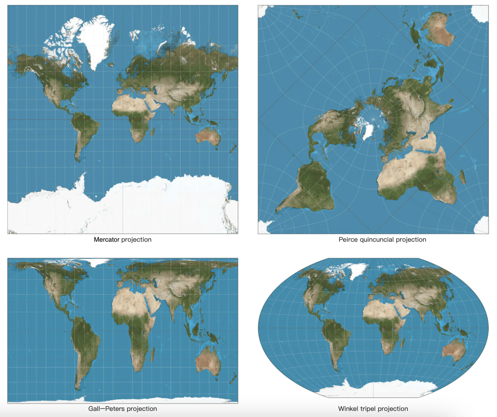
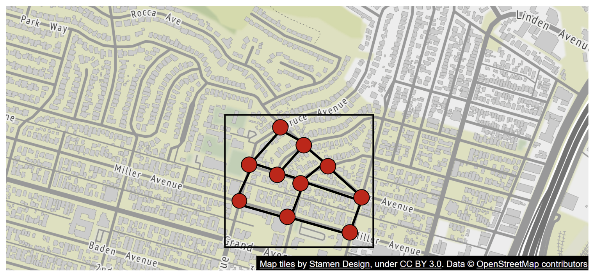
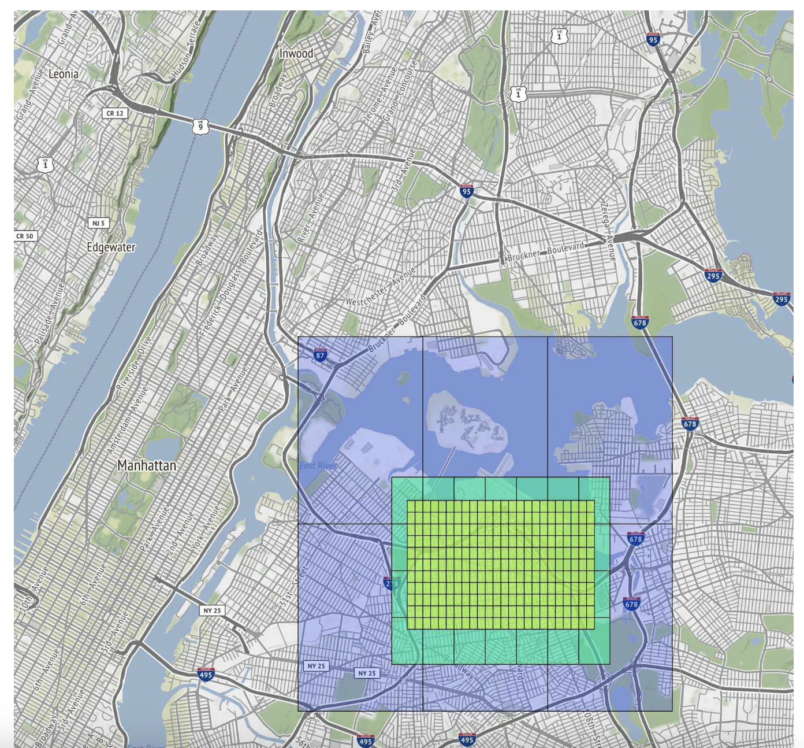
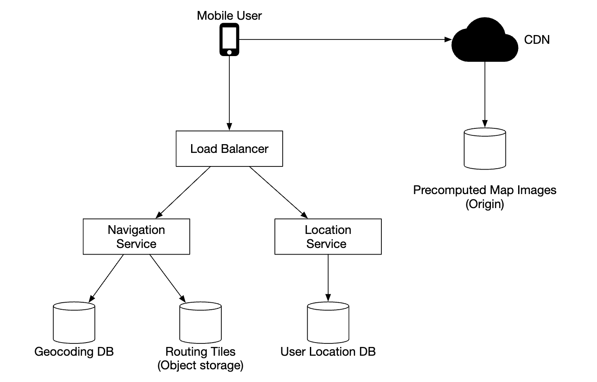

# Chapter 18: Google Maps System Design (नेविगेशन, रूटिंग और मैप रेंडरिंग)

## Introduction (भूमिका)
**Google Maps** दुनिया की सबसे जटिल और व्यापक जियोस्पाशियल इंजीनियरिंग प्रणालियों में से एक है। यह 1 Billion से अधिक Daily Active Users को सैटेलाइट इमेजरी, रियल-टाइम ट्रैफिक, टर्न-बाय-टर्न नेविगेशन और सबसे तेज़ रूट (Shortest / Fastest Path) प्रदान करता है।

### मुख्य फोकस एरियाज (Key Features)
1. **User Location Update:** यूज़र के जीपीएस (GPS) डेटा को कुशलता से कलेक्ट करना।
2. **Navigation & ETA (Estimated Time of Arrival):** ट्रैफिक के अनुसार सबसे तेज़ रास्ता और पहुँचने का समय बताना।
3. **Smooth Map Rendering:** मोबाइल फोन पर मैप को बिना अटके मोज़ेक (Mosaic Tiles) की तरह रेंडर करना।

---

## Step 1: Map 101 — मैप इंजीनियरिंग के 4 बुनियादी स्तंभ

### 1. 3D पृथ्वी से 2D स्क्रीन (Web Mercator Projection)

    

पृथ्वी गोल (3D Sphere) है, जबकि मोबाइल स्क्रीन 2D समतल है। Google Maps **Web Mercator Projection** का उपयोग करके 3D ग्लोब को 2D चौकोर मैप में बदलता है।

---

### 2. Map Tiling (मैप टाइलिंग - 256x256 पिक्सल ब्लॉक्स)
मैप कभी भी एक पूरी 50 GB की बड़ी इमेज के रूप में डाउनलोड नहीं होता! 
- पूरी दुनिया को छोटे-छोटे **$256 \times 256$ पिक्सल के टाइल्स (Map Tiles)** में काट दिया जाता है।
- **Zoom Levels (0 से 21):**
  - **Zoom Level 0:** पूरी दुनिया मात्र 1 टाइल ($256 \times 256$) में दिखती है।
  - **Zoom Level 1:** दुनिया 4 टाइल्स में बंट जाती है।
  - **Zoom Level $Z$:** कुल $4^Z$ टाइल्स बन जाती हैं।
  - जब आप किसी मोहल्ले या सड़क पर ज़ूम करते हैं (Zoom 18-20), तो मोबाइल फोन केवल उस स्क्रीन पर दिखने वाले 8-10 टाइल्स CDN से डाउनलोड करता है और उन्हें जोड़कर स्क्रीन पर चिपका देता है (**Smooth Mosaic Rendering**)।

---

### 3. Geocoding और Reverse Geocoding
- **Geocoding:** किसी पते (जैसे `"India Gate, New Delhi"`) को जीपीएस कोऑर्डिनेट्स `(28.6129° N, 77.2295° E)` में बदलना।
- **Reverse Geocoding:** जीपीएस कोऑर्डिनेट से गली का नाम और पिनकोड निकालना।

---

### 4. Road Networks & Routing Tiles (सड़क का ग्राफ मॉडल)

    

नेविगेशन एल्गोरिदम के लिए:
- सड़क के हर चौराहे (Intersection) को **Graph Node** माना जाता है।
- सड़क के हर हिस्से (Road Segment) को **Directed Graph Edge** माना जाता है।
- एज का वज़न (Weight) = सड़क की लंबाई + वर्तमान ट्रैफिक की स्पीड!

    

> [!TIP]
> **Hierarchical Routing Tiles (A* & Contraction Hierarchies):**
> यदि आपको दिल्ली से मुंबई जाना है, तो पूरे देश के 10 करोड़ लोकल चौराहों पर Dijkstra एल्गोरिदम चलाना असंभव होगा। 
> Google Maps **Hierarchical Routing** का उपयोग करता है:
> 1. दिल्ली के लोकल घर से नेशनल हाईवे तक: विस्तृत लोकल टाइल्स।
> 2. नेशनल हाईवे से मुंबई के बॉर्डर तक: केवल बड़े हाईवेज और एक्सप्रेसवे का हाई-लेवल नेटवर्क (Contraction Hierarchy).
> 3. मुंबई में प्रवेश करने के बाद: दोबारा विस्तृत लोकल टाइल्स।
> इससे रूट सेकंड के 100वें हिस्से (Sub-second) में कैलकुलेट हो जाता है!

---

## Step 2: High-Level Architecture Flow

    

1. **Location Service:** मोबाइल क्लाइंट हर 15-30 सेकंड में जीपीएस डेटा का बैच भेजता है। इसे **Kafka Stream** में डाला जाता है ताकि रियल-टाइम ट्रैफिक इंजन (Traffic Engine) सड़कों पर स्पीड का अंदाज़ा लगा सके।
2. **Navigation Service:** A* / Contraction Hierarchies एल्गोरिदम चलाकर सबसे तेज़ रूट और लाइव ट्रैफिक के अनुसार सटीक ETA निकालती है।
3. **Tile Rendering Service & CDN:** सभी प्री-रेंडर्ड मैप टाइल्स S3 और CloudFront CDN पर स्टोर होती हैं, जिससे मैप लोड होने में 0 मिलीसेकंड लेटेंसी लगती है।

