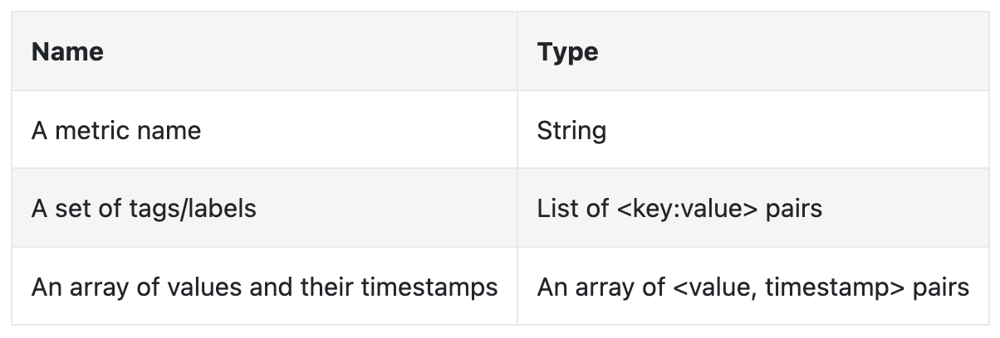
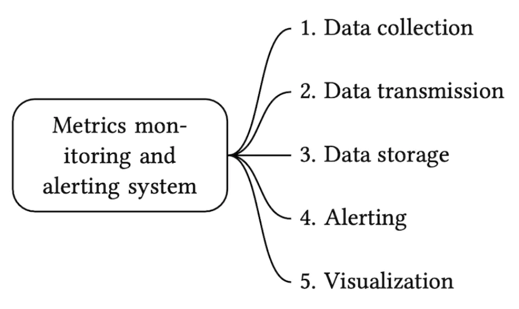

# Chapter 20: Metrics Monitoring and Alerting System (Prometheus / Datadog)

## Introduction (भूमिका)
एक **Metrics Monitoring and Alerting System** (जैसे Prometheus, Datadog, Grafana) किसी भी आधुनिक डिस्ट्रीब्यूटेड इंफ्रास्ट्रक्चर की आँख और कान होता है। यह हज़ारों सर्वर्स के CPU, Memory, Disk Space, QPS और नेटवर्क लेटेंसी को ट्रैक करता है और सिस्टम में कोई खराबी होने पर तुरंत ऑन-कॉल इंजीनियर को PagerDuty या Slack पर अलर्ट भेजता है।

### सिस्टम का पैमाना (Scale & Assumptions)
- **10 Million Metrics Data Points** प्रति मिनट कलेक्ट करना।
- **1-Year Data Retention Policy:**
  - पहले 7 दिन: Raw Metrics (सटीक सेकंड-दर-सेकंड डेटा)।
  - 8वें से 30वें दिन: 1-Minute Resolution (रोल-अप / डाउनसैंपलिंग)।
  - 30 दिन के बाद: 1-Hour Resolution (दीर्घकालिक रुझान देखने के लिए)।
- **Zero Missing Alerts:** कोई भी क्रिटिकल डाउनटाइम अलर्ट मिस नहीं होना चाहिए।

---

## Step 1: Time-Series Data Model (टाइम-सीरीज़ डेटा क्या है?)

पारंपरिक रिलेशनल डेटाबेस (MySQL) मैट्रिक्स के लिए उपयुक्त नहीं होते क्योंकि यहाँ डेटा **अत्यधिक Write-Heavy** होता है और हर रिकॉर्ड एक टाइमस्टैम्प से बंधा होता है।

<div style="margin-left:3rem">
    
</div>

### लाइन प्रोटोकॉल स्ट्रक्चर (Line Protocol):
```text
metric_name{label1=val1, label2=val2} timestamp value
```
*उदाहरण:*
```text
cpu.load{host=webserver_01, region=ap-south-1} 1613707265 86.4
```

### Time-Series Databases (TSDB) का चुनाव:
- **Prometheus & InfluxDB:** मैट्रिक्स स्टोरेज के इंडस्ट्री स्टैंडर्ड्स।
- **कम्प्रेशन:** Double-Delta Encoding (Gorilla Compression) का उपयोग करके टाइमस्टैम्प और फ्लोटिंग पॉइंट वैल्यूज को 90% तक कंप्रेस कर दिया जाता है (1 बाइट प्रति डेटा पॉइंट)।

---

## Step 2: Metrics Collection: Pull vs Push Architecture

<div style="margin-left:3rem">
    
</div>

### 1. Pull Model (Prometheus का तरीका)
- मैट्रिक्स सर्वर खुद समय-समय पर (हर 15 सेकंड में) सभी लक्ष्य सर्वर्स के `/metrics` एंडपॉइंट को HTTP GET रिक्वेस्ट भेजकर डेटा "खींचता" (Scrape) है।
- **फायदे:** 
  - सर्वर को पता होता है कि कौन सा नोड ज़िंदा है। यदि स्क्रैप फेल हुआ, तो तुरंत नोड डाउन अलर्ट ट्रिगर हो जाता है।
  - प्रोडक्शन सर्वर्स पर कोई अनचाहा लोड नहीं आता।

### 2. Push Model (Datadog / CloudWatch का तरीका)
- हर सर्वर पर एक डीमन/एजेंट चलता है जो सीधे मैट्रिक्स कलेक्टर को डेटा भेजता है।
- **फायदे:** शॉर्ट-लिव्ड जॉब्स (जैसे AWS Lambda, बैच स्क्रिप्ट्स) के लिए बेस्ट है जो कुछ ही सेकंड्स में खत्म हो जाते हैं।

---

## Step 3: Alerting Engine (अलर्टिंग और विजुअलाइजेशन)

1. **Alert Rules Evaluation:** 
   - अलर्ट इंजन समय-समय पर रूल्स रन करता है:
     ```yaml
     alert: HighCpuUsage
     expr: cpu_usage > 85
     for: 5m
     ```
   - यदि लगातार 5 मिनट तक CPU 85% से ऊपर रहता है, तो अलर्ट की स्टेट `FIRING` हो जाती है।
2. **Alert Manager:** 
   - **Deduplication & Grouping:** यदि 50 सर्वर्स एक साथ क्रैश होते हैं, तो इंजीनियर को 50 अलग-अलग SMS भेजने के बजाय एक ही समरी अलर्ट भेजा जाता है।
   - **Silencing:** मेंटेनेंस विंडो के दौरान अलर्ट्स को म्यूट रखना।
3. **Visualization (Grafana Dashboard):** इंजीनियरों को रियल-टाइम ग्राफ्स और हीटमैप्स दिखाना।

