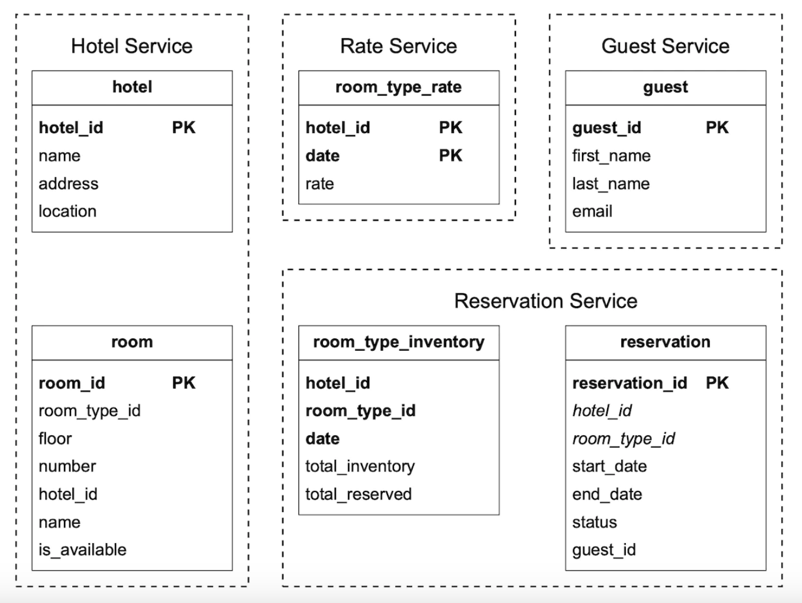
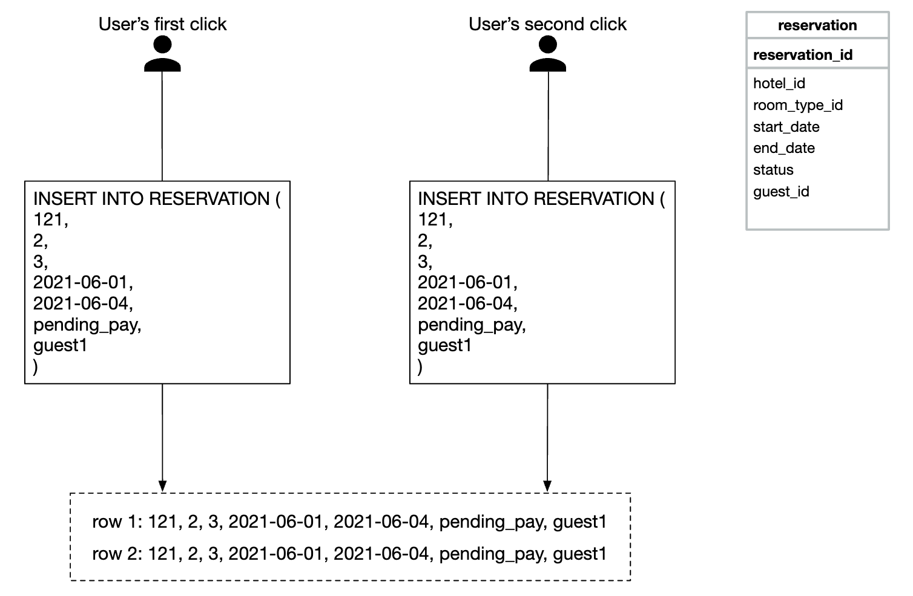

# Chapter 22: Hotel Reservation System Design (Airbnb / Booking.com / Marriott)

## Introduction (भूमिका)
इस चैप्टर में हम एक बड़े पैमाने का **Hotel Reservation System** (जैसे Booking.com, Airbnb, या Marriott) डिज़ाइन करेंगे। 

यह सिस्टम हवाई टिकट बुकिंग (Flight Booking) और मूवी टिकट बुकिंग (BookMyShow) सिस्टम्स के समान कोर प्रिंसिपल्स पर काम करता है।

### सिस्टम की मुख्य आवश्यकताएं (Requirements)
- **5,000 होटल्स और 1,000,000 (1 Million) कमरे**।
- **High Concurrency & Zero Double Booking:** पीक सीज़न में जब एक ही आखिरी कमरे के लिए 100 यूज़र्स एक साथ "Book Now" दबाएं, तो केवल 1 यूज़र को कमरा मिलना चाहिए, बाकियों को "Sold Out" दिखना चाहिए।
- **10% Overbooking Support:** होटल्स कैंसिलेशन की उम्मीद में कुल क्षमता से 10% अतिरिक्त बुकिंग्स स्वीकार करते हैं।
- **Dynamic Room Pricing:** कमरे का किराया उपलब्धता और तारीख के अनुसार रोज़ बदलता है।

---

## Step 1: Improved Data Model (कमरा नंबर vs रूम टाइप)

होटल बुकिंग में यूज़र विशिष्ट कमरा (जैसे Room #304) बुक नहीं करता, बल्कि **Room Type** (जैसे Deluxe King, Standard Queen) बुक करता है।

<div style="margin-left:3rem">
    
</div>

### मुख्य इन्वेंट्री टेबल (`room_type_inventory`):
| hotel_id | room_type_id | date | total_inventory | total_reserved |
| :--- | :--- | :--- | :--- | :--- |
| 211 (Marriott) | 1001 (Deluxe) | 2026-11-01 | 100 | 80 |
| 211 (Marriott) | 1001 (Deluxe) | 2026-11-02 | 100 | 82 |

- **कमरे की उपलब्धता की जांच (Overbooking सहित):**
  $$\text{total\_reserved} + \text{requested\_rooms} \le 110\% \times \text{total\_inventory}$$

---

## Step 2: Concurrency Handling (डबल बुकिंग रोकने के 4 तरीके)

डबल बुकिंग की समस्या दो तरह से होती है:
1. **एक ही यूज़र का दो बार क्लिक करना:** इसका समाधान **Idempotency Key (`reservation_id`)** है।
2. **दो अलग यूज़र्स का एक ही कमरे के लिए एक साथ प्रयास करना:**

<div style="margin-left:3rem">
    
</div>

### 1. Pessimistic Locking (`SELECT ... FOR UPDATE`)
- जब यूज़र कमरा बुक करने जाता है, तो डेटाबेस की उस पंक्ति (Row) पर एक्सक्लूसिव लॉक लगा दिया जाता है।
- **Pros:** 100% डेटा सुरक्षा।
- **Cons:** भारी लोड में बहुत धीमा हो जाता है, डेडलॉक्स (Deadlocks) का खतरा बढ़ता है।

### 2. Optimistic Locking (वर्जन नंबर के साथ)
- पंक्ति में एक `version` कॉलम रखा जाता है:
  ```sql
  UPDATE room_type_inventory
  SET total_reserved = total_reserved + 1, version = version + 1
  WHERE room_type_id = :id AND date = :date AND version = :old_version;
  ```
- यदि किसी अन्य यूज़र ने बीच में बुक कर लिया, तो `version` बदल चुका होगा और यह क्वेरी 0 पंक्तियाँ अपडेट करेगी।
- **Pros:** कोई डेटाबेस लॉक नहीं, सामान्य दिनों में बहुत तेज़।
- **Cons:** पीक सेल (जैसे तत्काल टिकट) में जब 1000 लोग 1 कमरे पर टूट पड़ते हैं, तो 999 ट्रांजेक्शन्स रोलबैक हो जाते हैं।

### 3. Database Constraints (सबसे सरल और सुंदर)
```sql
ALTER TABLE room_type_inventory
ADD CONSTRAINT check_inventory_limit 
CHECK (total_reserved <= total_inventory * 1.1);
```
डेटाबेस इंजन खुद ही गारंटी देता है कि अगर रिज़र्वेशन सीमा पार करेगा तो ट्रांजेक्शन एरर के साथ फेल हो जाएगा।

### 4. Distributed Redis Lock (Redlock / Lua Script)
- यदि माइक्रो-सर्विसेज कई डेटाबेस शार्द्स में बंटी हैं, तो **Redis Distributed Lock (या Redis Decrby Inventory)** का उपयोग करके सब-मिलीसेकंड में इन्वेंट्री रिज़र्व की जाती है।
- यूज़र को पेमेंट पूरा करने के लिए **10 मिनट का टाइमर (TTL)** दिया जाता है। यदि 10 मिनट में पेमेंट नहीं हुई, तो कमरा वापस इन्वेंट्री में रिलीज़ हो जाता है।

---

## Step 3: माइक्रो-सर्विसेज में डेटा संगति (Saga Pattern)

बुकिंग फ्लो में 3 सर्विसेज शामिल होती हैं:
`Reservation Service` $\to$ `Payment Service` $\to$ `Notification Service`
- यदि पेमेंट गेटवे फेल हो जाए, तो **Saga Orchestrator** तुरंत **Compensating Transaction** चलाकर रिज़र्वेशन कैंसिल करता है और कमरे को दोबारा इन्वेंट्री में खाली कर देता है।

