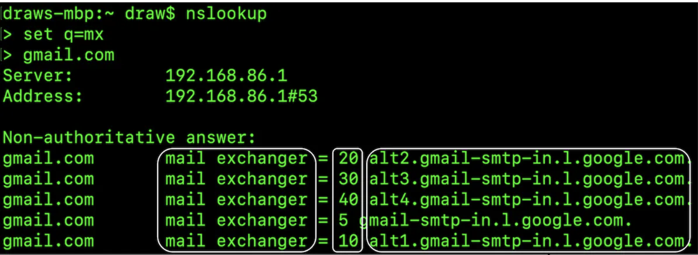
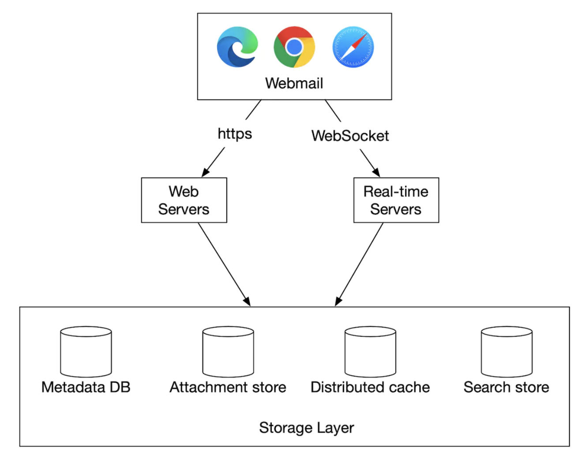
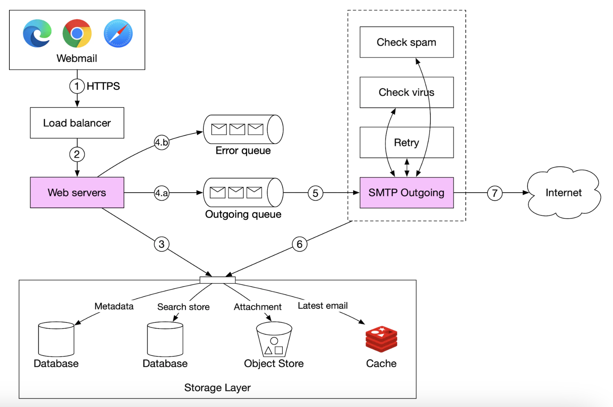

# Chapter 23: Distributed Email Service Design (Gmail / Outlook Scale)

## Introduction (भूमिका)
**Gmail** (1.8 Billion+ यूज़र्स) और **Microsoft Outlook** (400 Million+ यूज़र्स) दुनिया की सबसे व्यापक ईमेल प्रणालियाँ हैं। 

इस चैप्टर में हम एक ऐसा डिस्ट्रीब्यूटेड ईमेल सिस्टम डिज़ाइन करेंगे जो:
- अरबों ईमेल्स को सुरक्षित रूप से भेजना और प्राप्त करना (Send & Receive)।
- ईमेल अटैचमेंट्स (PDFs, Images, Videos) को स्केल पर स्टोर करना।
- अल्ट्रा-फ़ास्ट फुल-टेक्स्ट ईमेल सर्च (Full-Text Search)।
- एंटी-स्पैम और एंटी-वायरस फ़िल्टरिंग।

### सिस्टम का पैमाना (Scale & Estimates)
- **1 Billion Users** $\implies$ औसतन प्रति व्यक्ति 10 ईमेल्स/दिन $\implies \mathbf{100,000\text{ Emails / Second}}$।
- प्रतिदिन 40 ईमेल्स प्रति यूज़र $\implies$ सालाना ईमेल मेटाडेटा स्टोरेज $\approx \mathbf{730\text{ PB}}$।
- अटैचमेंट्स (Attachments Storage) $\approx \mathbf{1,460\text{ PB}}$ प्रति वर्ष।

---

## Step 1: Email 101 — मुख्य प्रोटोकॉल्स

    

1. **SMTP (Simple Mail Transfer Protocol):** सर्वर-से-सर्वर और क्लाइंट-से-सर्वर ईमेल **भेजने (Push)** का वैश्विक मानक प्रोटोकॉल (Port 25 / 587)।
2. **POP3 (Post Office Protocol):** सर्वर से ईमेल डाउनलोड करने का पुराना प्रोटोकॉल। डाउनलोड होने के बाद ईमेल सर्वर से डिलीट हो जाता है (मल्टी-डिवाइस के लिए अनुपयुक्त)।
3. **IMAP (Internet Message Access Protocol):** सर्वर पर ईमेल्स सुरक्षित रखते हुए सभी डिवाइसेस (फोन, लैपटॉप) पर ईमेल्स सिंक करता है।
4. **HTTPS / Webmail REST API (Gmail का तरीका):** आधुनिक ब्राउज़र आधारित ईमेल के लिए HTTP/JSON का उपयोग किया जाता है।
5. **DNS MX Records (Mail Exchanger):** जब आप `alice@gmail.com` को मेल भेजते हैं, तो आपका सर्वर DNS से `gmail.com` का **MX Record** पूछता है ताकि पता चले कि गूगल का मेल सर्वर किस IP पर है।

---

## Step 2: High-Level Architecture (डिस्ट्रीब्यूटेड आर्किटेक्चर)

    

### मुख्य कंपोनेंट्स:
1. **Web Servers (HTTP APIs):** लॉगिन, फोल्डर्स, ड्राफ्ट्स और मेल कंपोज़ करने के लिए।
2. **Metadata Storage (Apache Cassandra / Google Spanner):** 
   - ईमेल हेडर, बॉडी, लेबल्स (`Inbox`, `Sent`, `Spam`), और रीड/अनरीड स्टेटस रखता है।
   - **Cassandra का चुनाव क्यों?** ईमेल डेटा में कभी `UPDATE` नहीं होता (अपेंड-ओनली)। Cassandra सीक्वेंशियल राइट्स और पेटाबाइट्स डेटा को हॉरिजॉन्टली स्केल करने में सर्वश्रेष्ठ है।
3. **Attachment Storage (Object Store - Amazon S3):** 25 MB तक की फाइल्स को सीधे S3 में रखा जाता है, और ईमेल बॉडी में केवल उसका URL पॉइंटर दिया जाता है।
4. **Search Store (Elasticsearch):** ईमेल सब्जेक्ट और बॉडी का **Inverted Index** बनाकर सब-सेकंड में सर्च रिजल्ट्स देता है।

---

## Step 3: Email Sending Flow (ईमेल भेजने का प्रवाह)

    

1. यूज़र वेबमेल पर "Send" दबाता है।
2. वेब सर्वर बेसिक वैलिडेशन (फाइल साइज, रेसिपिएंट फॉर्मेट) करता है।
3. मैसेज को **Outgoing Kafka Queue** में डाल दिया जाता है।
4. **Spam & Antivirus Workers:** मशीन लर्निंग मॉडल्स से स्पैम स्कोर चेक करते हैं।
5. **SMTP Outgoing Workers:** 
   - रेसिपिएंट डोमेन का DNS MX रिकॉर्ड खोजते हैं।
   - बाहरी सर्वर (जैसे Yahoo/Outlook) के साथ TLS/SMTP कनेक्शन बनाकर ईमेल ट्रांसफर करते हैं।
   - यदि बाहरी सर्वर डाउन हो, तो **Exponential Backoff** के साथ कतार में री-ट्राई किया जाता है।

