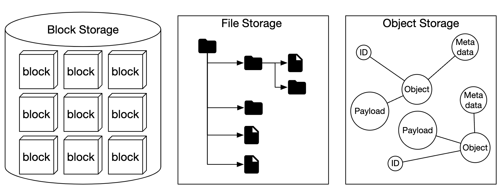
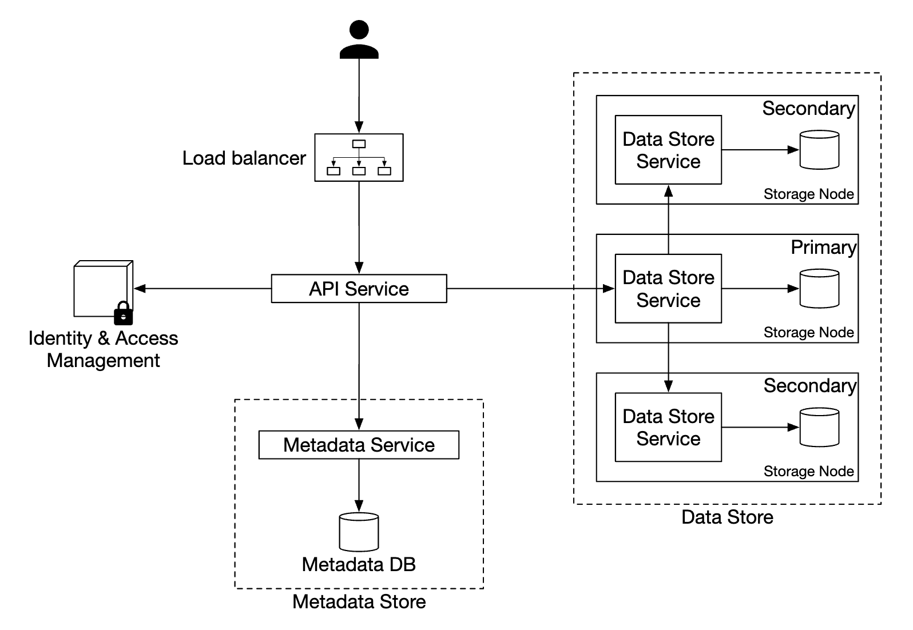
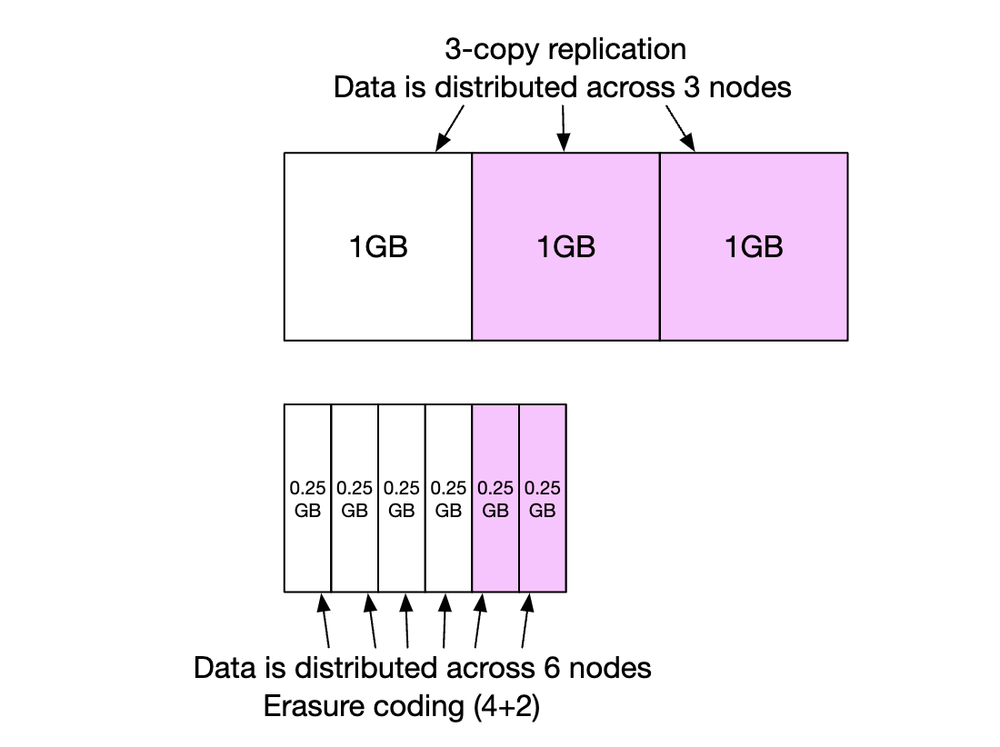
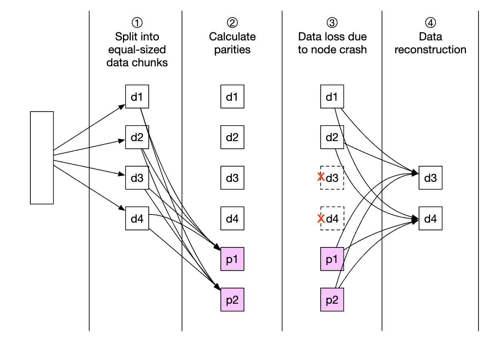
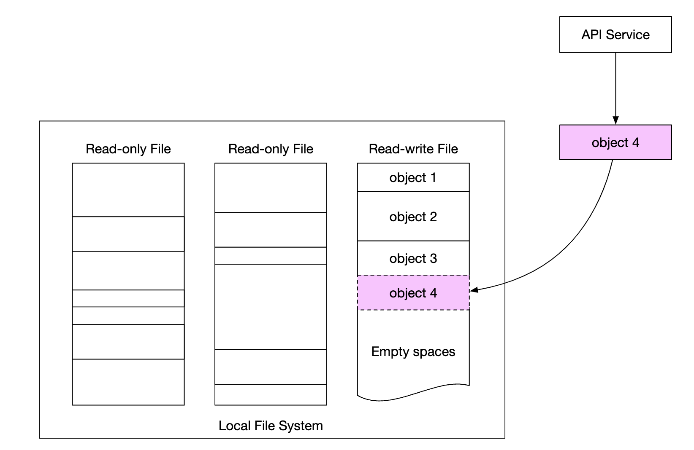

# Chapter 24: S3-like Object Storage Design (Amazon S3 / MinIO)

## Introduction (भूमिका)
स्टोरेज सिस्टम्स मुख्य रूप से 3 प्रकार के होते हैं:
1. **Block Storage:** हार्ड ड्राइव (HDD/SSD) और SAN/iSCSI। वर्चुअल मशीन्स और डेटाबेस के लिए सबसे तेज़।
2. **File Storage:** NFS और SMB। डायरेक्टरी और फाइलों का हायरार्किकल ढांचा।
3. **Object Storage (Amazon S3, Google GCS, Ceph, MinIO):** पेटाबाइट्स और एक्साबाइट्स के अनस्ट्रक्चर्ड बाइनरी डेटा (इमेजेस, वीडियोज, बैकअप्स) के लिए फ्लैट की-वैल्यू ढांचा।

    

### मुख्य आवश्यकताएं और SLA (Non-Functional Requirements)
- **100 Petabytes (PB)** डेटा स्टोरेज।
- **11 Nines of Data Durability (99.999999999%):** पूरे विश्व में किसी भी डेटा ब्लॉक के नष्ट होने की संभावना 1 ट्रिलियन में 1 होनी चाहिए।
- **Immutable Objects:** ऑब्जेक्ट्स को अपडेट नहीं किया जा सकता (Write-Once-Read-Many - WORM)।

---

## Step 1: High-Level Architecture (Metadata Store vs Data Store)

UNIX फाइल सिस्टम की तरह, ऑब्जेक्ट स्टोरेज में **मेटाडेटा (Metadata)** और **रॉ बाइनरी डेटा (Raw Data)** को पूरी तरह अलग-अलग सर्वर्स पर रखा जाता है:

    

1. **API Service:** RESTful HTTP PUT / GET / DELETE रिक्वेस्ट्स को हैंडल करता है।
2. **Metadata Store (RocksDB / Spanner):** ऑब्जेक्ट का नाम, बकेट, साइज, ओनर और UUID रखता है।
3. **Data Store (Data Nodes):** वास्तविक बाइट्स को हार्ड ड्राइव्स पर स्टोर करता है।
4. **Placement Service (Raft Consensus Cluster):** डेटा नोड्स की सेहत मॉनिटर करता है और क्लस्टर की वर्चुअल टोपोलॉजी मैनेज करता है।

---

## Step 2: 3x Replication vs Erasure Coding (11 Nines Durability)

डेटा को क्रैश से बचाने के दो तरीके हैं:

    

### 1. 3x Replication (3 गुना प्रतिकृति)
- हर फाइल की 3 अलग-अलग सर्वर/रैक्स पर पूरी कॉपियां रखना।
- **समस्या:** **200% स्टोरेज ओवरहेड**! यदि 100 PB डेटा स्टोर करना है, तो 300 PB हार्ड ड्राइव्स खरीदनी पड़ेंगी।

### 2. Erasure Coding (8+4 Reed-Solomon Code - S3 का गुप्त हथियार)

    

- डेटा को 8 डेटा चंक्स ($k=8$) और 4 पैरिटी चंक्स ($m=4$) में विभाजित किया जाता है (कुल 12 नोड्स)।
- **जादू:** इन 12 नोड्स में से **कोई भी 4 नोड्स एक साथ क्रैश या जल जाएं**, तब भी बचे हुए 8 नोड्स से गणितीय मैट्रिक्स (Vandermonde Matrix) द्वारा 100% ओरिजिनल डेटा पुनर्निर्मित (Reconstruct) हो जाता है!
- **स्टोरेज ओवरहेड:** केवल **50%** (200% की जगह)। 
- **Durability:** सीधे **11 Nines (99.999999999%)** हासिल हो जाती है, जिससे अरबों रुपये की बचत होती है।

---

## Step 3: Small File Problem और Append-Only WAL

यदि अरबों छोटी फाइल्स (जैसे 50 KB की तस्वीरें) को अलग-अलग फाइलों के रूप में डिस्क पर लिखा जाए:
- ऑपरेटिंग सिस्टम के **Inodes** खत्म हो जाएंगे।
- 4 KB सेक्टर पैडिंग के कारण भारी डिस्क स्पेस बर्बाद होगा।

    

### समाधान (Facebook Haystack / S3 Approach):
हज़ारों छोटी फाइलों को एक बड़ी 2 GB से 10 GB की **Append-Only Write-Ahead Log (Container File)** में जोड़ दिया जाता है।
- लोकल **RocksDB** में केवल मैपिंग रखी जाती है:
  `object_uuid -> {container_file: "data_0042.dat", offset: 1048576, size: 51200}`।
- इससे डिस्क पर केवल सीक्वेंशियल राइट्स होते हैं और Inodes कभी नहीं भरते।

