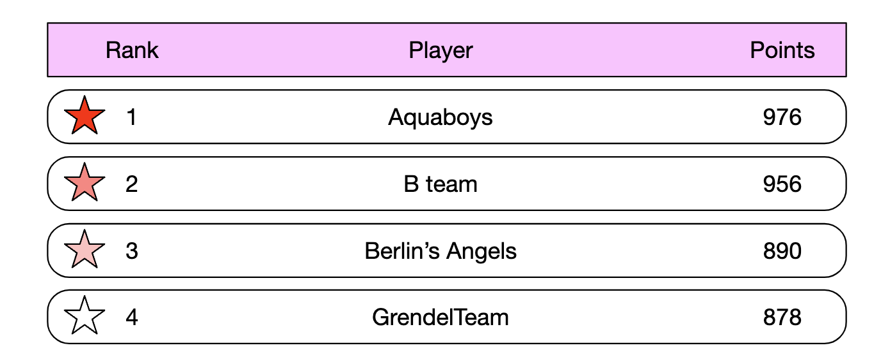
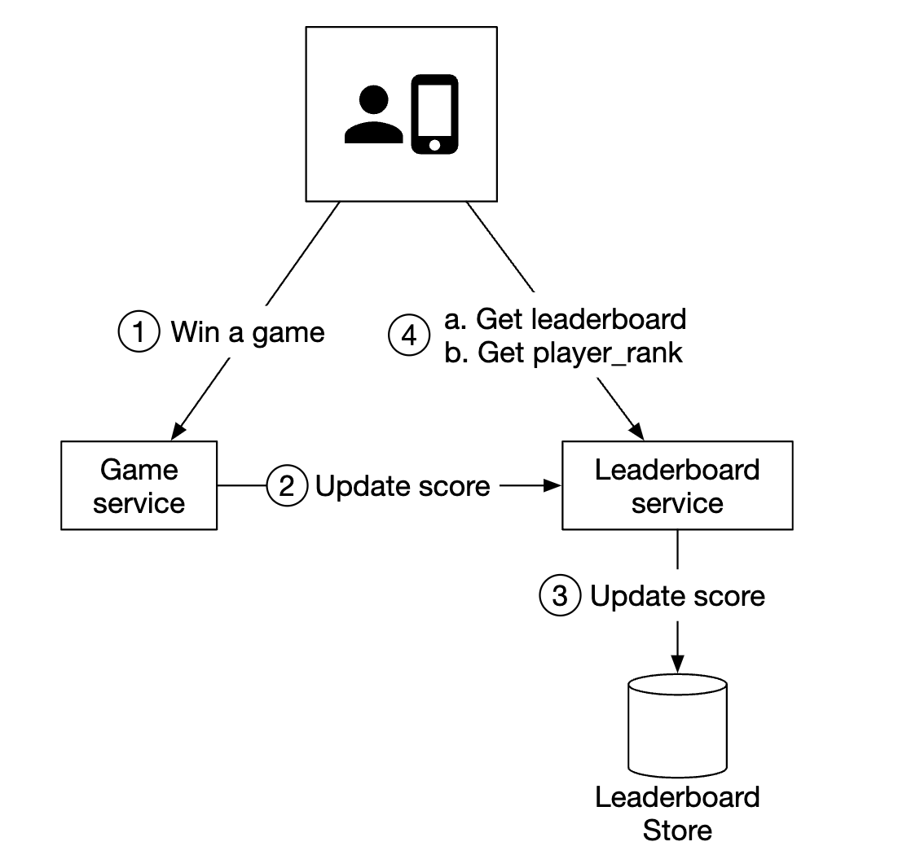
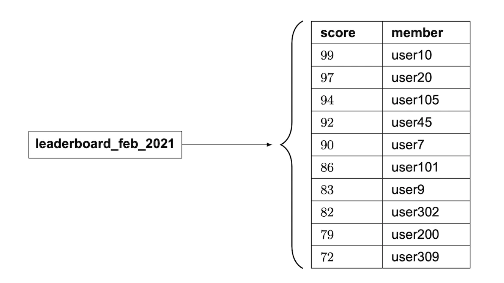
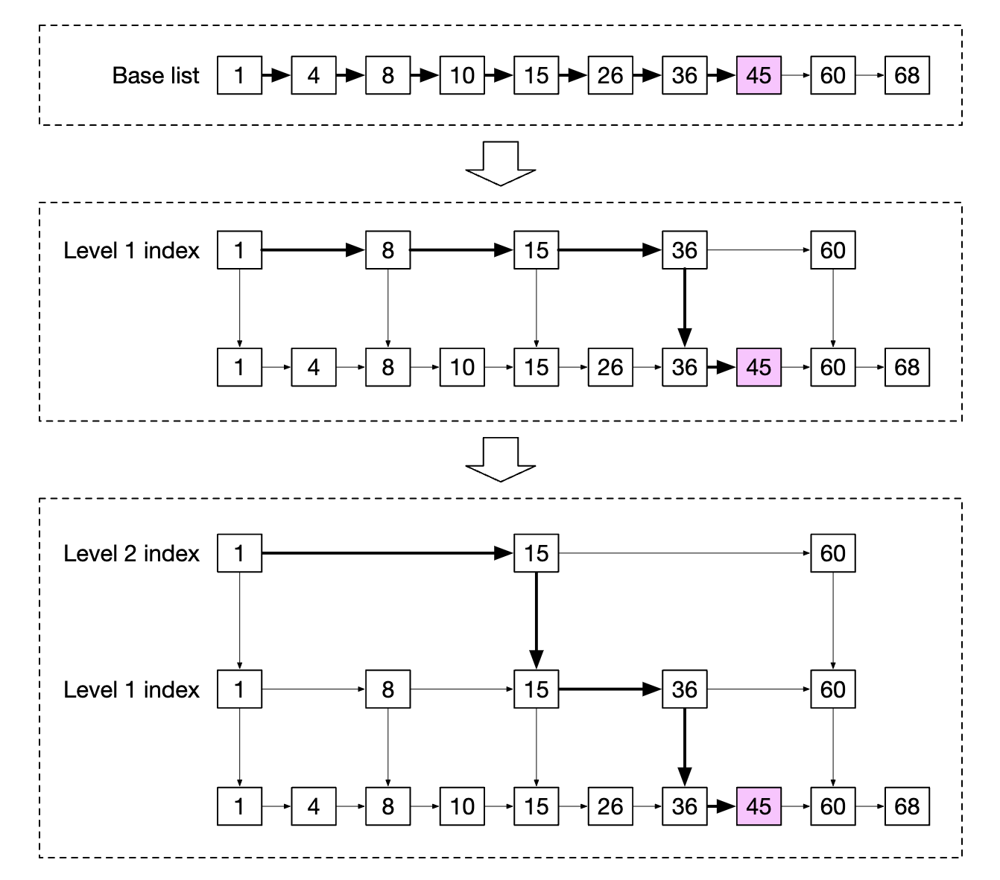
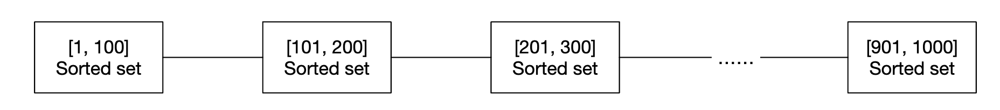

# Chapter 25: Real-time Gaming Leaderboard (रियल-टाइम गेमिंग लीडरबोर्ड)

## Introduction (भूमिका)
इस चैप्टर में हम एक बड़े पैमाने के ऑनलाइन मोबाइल गेम (जैसे PUBG, Call of Duty, या Chess.com) के लिए **Real-time Leaderboard** सिस्टम डिज़ाइन करेंगे।

लीडरबोर्ड खिलाड़ियों को गेम में उनके प्रदर्शन (Score) के आधार पर रैंक करता है। जब भी कोई खिलाड़ी मैच जीतता है, उसका स्कोर तुरंत अपडेट होना चाहिए और लीडरबोर्ड पर उसकी रैंक रियल-टाइम में बदलनी चाहिए।

<div style="margin-left:3rem">
    
</div>

---

## Step 1: Understand the Problem and Establish Design Scope (समस्या को समझना)

सिस्टम डिज़ाइन इंटरव्यू में पहला काम इंटरव्यूअर से सवाल पूछकर स्कोप तय करना होता है:

- **C (Candidate):** लीडरबोर्ड के लिए स्कोर की गणना कैसे होती है?
- **I (Interviewer):** जब भी कोई यूज़र मैच जीतता है, उसे 1 पॉइंट मिलता है।
- **C:** क्या गेम के सभी खिलाड़ी लीडरबोर्ड में शामिल होते हैं?
- **I:** हाँ, सभी एक्टिव खिलाड़ी शामिल होते हैं।
- **C:** क्या लीडरबोर्ड का कोई निश्चित टाइम सेगमेंट (Time Window) होता है?
- **I:** हर महीने एक नया टूर्नामेंट शुरू होता है, जिसके साथ एक नया मासिक (Monthly) लीडरबोर्ड शुरू होता है। पुराने लीडरबोर्ड्स को आर्काइव कर दिया जाता है।
- **C:** क्या हमें केवल Top 10 यूज़र्स की चिंता करनी है?
- **I:** हमें Top 10 यूज़र्स प्रदर्शित करने हैं, साथ ही किसी विशिष्ट खिलाड़ी की उसकी खुद की सटीक रैंक (जैसे #358) भी दिखानी है। यदि समय मिले, तो यूज़र के ऊपर-नीचे के 4-4 खिलाड़ियों (Bonus Feature) को दिखाने पर भी चर्चा कर सकते हैं।
- **C:** एक टूर्नामेंट में कितने यूज़र्स होते हैं?
- **I:** **5 Million DAU** (Daily Active Users) और **25 Million MAU** (Monthly Active Users).
- **C:** औसतन एक खिलाड़ी प्रतिदिन कितने मैच खेलता है?
- **I:** प्रति खिलाड़ी प्रतिदिन औसतन **10 मैच** खेलता है।
- **C:** यदि दो खिलाड़ियों का स्कोर समान हो (Tie), तो रैंक कैसे तय करेंगे?
- **I:** उस स्थिति में दोनों की रैंक समान होगी। समय मिले तो टाई-ब्रेकिंग लॉजिक (जिसने पहले स्कोर किया) पर बात करेंगे।
- **C:** क्या लीडरबोर्ड को रियल-टाइम होना अनिवार्य है?
- **I:** हाँ, स्कोर बदलते ही परिणाम रियल-टाइम या उसके बेहद करीब (Near Real-Time) दिखने चाहिए। बैच प्रोसेसिंग (जैसे रात में रैंक कैलकुलेट करना) स्वीकार्य नहीं है।

---

### Functional Requirements
1. **Top 10 Leaderboard:** ग्लोबल Top 10 खिलाड़ियों की सूची (User ID, Name, Score, Rank) दिखाना।
2. **User Rank Lookup:** किसी भी खिलाड़ी की वर्तमान सटीक रैंक प्रदर्शित करना।
3. **Surrounding Players (Bonus):** खिलाड़ी के ऊपर के 4 और नीचे के 4 खिलाड़ियों की रैंक और स्कोर दिखाना।

### Non-Functional Requirements
1. **Real-time Updates:** मैच जीतते ही 1 सेकंड से कम में लीडरबोर्ड अपडेट होना चाहिए।
2. **High Throughput & Scalability:** 5 Million DAU के स्कोर अपडेट्स और रीड्स को संभालना।
3. **High Availability & Fault Tolerance:** सर्वर क्रैश होने पर भी स्कोर डेटा नष्ट नहीं होना चाहिए।

---

### Back-of-the-Envelope Estimation (क्षमता और QPS का अनुमान)

- **Daily Active Users (DAU):** 5 Million खिलाड़ी।
- **Score Updates QPS:**
  - प्रति खिलाड़ी 10 मैच प्रतिदिन:
    $$\text{Total Daily Matches} = 5,000,000 \times 10 = 50,000,000 \text{ मैच/दिन}$$
  - दिन में लगभग 100,000 सेकंड होते हैं:
    $$\text{Average Write QPS} = \frac{50,000,000}{100,000} = 500 \text{ QPS}$$
  - पीक आवर्स (Peak Hours) में ट्रैफिक 5x तक जा सकता है:
    $$\text{Peak Write QPS} = 500 \times 5 = 2,500 \text{ QPS}$$
- **Read QPS (Top 10 Fetch):**
  - यदि हर खिलाड़ी दिन में औसतन 1 बार लीडरबोर्ड खोलता है:
    $$\text{Average Read QPS} = \frac{5,000,000}{100,000} = 50 \text{ QPS} \quad (\text{Peak} \approx 250 \text{ QPS})$$
- 2,500 Writes/sec और 250 Reads/sec किसी भी मॉडर्न इन-मेमोरी डेटाबेस (जैसे Redis) के लिए बहुत आसान है।

---

## Step 2: High-Level Design (हाई-लेवल आर्किटेक्चर)

### API Design (कोर एंडपॉइंट्स)

1. **Update User Score:**
   ```http
   POST /v1/scores
   Content-Type: application/json

   {
     "user_id": "player_alice",
     "points": 1
   }
   ```
   > [!IMPORTANT]
   > यह API केवल बैकएंड **Game Server** द्वारा कॉल की जानी चाहिए, एंड-यूज़र मोबाइल ऐप द्वारा सीधे नहीं। यदि मोबाइल ऐप सीधे स्कोर अपडेट भेजेगी, तो हैकर्स प्रॉक्सी लगाकर अपना स्कोर मनचाहा बढ़ा लेंगे!

2. **Fetch Top 10 Players:**
   ```http
   GET /v1/scores/top?limit=10
   ```

3. **Get Specific User Rank & Score:**
   ```http
   GET /v1/scores/users/{user_id}
   ```

---

### High-Level Architecture Flow

<div style="margin-left:3rem">
    
</div>

1. खिलाड़ी गेम जीतता है $\to$ मोबाइल ऐप गेम सर्वर को मैच रिजल्ट भेजती है।
2. गेम सर्वर मैच के नियमों को सत्यापित (Validate) करता है और **Leaderboard Service** को स्कोर बढ़ाने का आदेश देता है।
3. Leaderboard Service इन-मेमोरी डेटा स्टोर (Redis Sorted Set) में स्कोर अपडेट करती है।
4. जब यूज़र लीडरबोर्ड खोलता है, तो रिक्वेस्ट सीधे रीड-ऑप्टिमाइज़्ड कैश से Top 10 डेटा लाकर तुरंत स्क्रीन पर दिखा देती है।

---

## डेटाबेस का चुनाव: Relational DB vs Redis Sorted Sets

### 1. Relational Database (MySQL) क्यों फेल हो जाता है?
यदि हम पारंपरिक MySQL टेबल में स्कोर रखें:
```sql
SELECT (@rownum := @rownum + 1) AS rank, user_id, score
FROM leaderboard
ORDER BY score DESC;
```
- **समस्या:** जब 25 Million रिकॉर्ड्स हों, तो हर बार किसी यूज़र की रैंक निकालने के लिए पूरे टेबल को सॉर्ट (Full Table Scan & Sort) करना पड़ेगा।
- 2,500 Writes/sec के भारी लोड में MySQL का CPU 100% पर लॉक हो जाएगा और डिस्क I/O चोक हो जाएगा।

---

### 2. The Ideal Solution: Redis Sorted Sets (ZSET)
Redis का **Sorted Set (ZSET)** लीडरबोर्ड के लिए दुनिया का सबसे बेहतरीन और उद्योग-मानक डेटा स्ट्रक्चर है।

<div style="margin-left:3rem">
    
</div>

#### आंतरिक संरचना (Under the Hood):
Redis Sorted Set दो डेटा स्ट्रक्चर्स के संयोजन से बना होता है:
1. **Hash Map:** `user_id -> score` का मैपिंग रखता है ($O(1)$ में स्कोर लुकअप)।
2. **Skip List (स्किप लिस्ट):** स्कोर के अनुसार यूज़र्स को सॉर्टेड लिंक्ड लिस्ट और मल्टी-लेवल इंडेक्स में रखता है।

<div style="margin-left:3rem">
    
</div>

#### टाइम कॉम्प्लेक्सिटी (Time Complexity):
- **नया स्कोर जोड़ना या बढ़ाना (`ZADD` / `ZINCRBY`):** $O(\log N)$
- **Top 10 खिलाड़ी निकालना (`ZREVRANGE 0 9`):** $O(\log N + M)$ जहाँ $M = 10$.
- **किसी भी यूज़र की रैंक खोजना (`ZREVRANK user_id`):** मात्र $O(\log N)$!

25 Million यूज़र्स के लिए $\log_2(25,000,000) \approx 25$ ऑपरेशन्स! इसका मतलब है कि 1 मिलीसेकंड से भी कम समय में किसी भी यूज़र की सटीक रैंक मिल जाती है।

---

### Redis Commands का वास्तविक उपयोग

1. **स्कोर अपडेट करना:**
   ```bash
   ZINCRBY leaderboard_2026_11 1 "player_alice"
   ```
2. **Top 10 पोडियम फेच करना:**
   ```bash
   ZREVRANGE leaderboard_2026_11 0 9 WITHSCORES
   ```
3. **किसी यूज़र की रैंक जानना:**
   ```bash
   ZREVRANK leaderboard_2026_11 "player_alice"
   # रिटर्न: 0 (मतलब Rank #1)
   ```
4. **यूज़र के आस-पास के 4 ऊपर और 4 नीचे के खिलाड़ी निकालना:**
   - यदि एलिस की रैंक 360 है:
   ```bash
   ZREVRANGE leaderboard_2026_11 356 364 WITHSCORES
   ```

---

## Step 3: Storage और Memory की गणना

- 25 Million MAU यूज़र्स।
- प्रत्येक एंट्री: 
  - `user_id`: 24 बाइट्स स्ट्रिंग
  - `score`: 8 बाइट्स 64-bit float
  - Skip list pointers & hash overhead: ~32 बाइट्स
  - कुल प्रति रिकॉर्ड: $\approx 64 \text{ बाइट्स}$
- **कुल मेमोरी की खपत:**
  $$25,000,000 \times 64 \text{ Bytes} \approx 1.6 \text{ GB RAM}!$$
- 1.6 GB RAM आज के किसी भी साधारण क्लाउड सर्वर में आसानी से समा जाती है।

---

## Step 4: Scale-Out और Sharding (जब यूज़र्स 500 Million हो जाएं)

यदि यूज़र बेस 10x या 20x बढ़ जाए (उदा. 500 Million यूज़र्स), तो मेमोरी और QPS दोनों को स्केल करने के लिए **Redis Sharding** की जाती है:

<div style="margin-left:3rem">
    
</div>

### Fixed Score-Range Sharding (अनुशंसित तरीका)
हम स्कोर के आधार पर शार्द्स (Shards) बना देते हैं:
- **Shard 1:** 0 – 500 स्कोर
- **Shard 2:** 501 – 1500 स्कोर
- **Shard 3:** 1501 – 3000 स्कोर
- **Shard 4 (Top Tier):** 3000+ स्कोर
- **Top 10 फेच करना:** केवल सबसे उच्चतम शार्द (Shard 4) से सीधे `ZREVRANGE 0 9` क्वेरी करें।
- **यूज़र की ग्लोबल रैंक निकालना:** 
  $$\text{Global Rank} = \text{Rank in Current Shard} + \sum (\text{Total Users in All Higher Shards})$$
  चूंकि उच्च शार्द्स के कुल यूज़र्स की संख्या $O(1)$ में `DBSIZE` से मिल जाती है, इसलिए यह ऑपरेशन बेहद तेज़ रहता है।

---

## Step 5: विफलता और आपदा रिकवरी (Disaster Recovery)
- **Redis AOF / RDB Snapshots:** डिस्क पर निरंतर पर्सिस्टेंस।
- **Read Replicas:** रीड ट्रैफिक को मास्टर से अलग करने के लिए Redis Replicas का उपयोग।
- **MySQL Backup:** सभी मैच विन इवेंट्स को MySQL / DynamoDB में अपेंड-ओनली टेबल में सुरक्षित रखा जाता है। यदि Redis क्लस्टर पूरी तरह नष्ट भी हो जाए, तो एक रिकवरी स्क्रिप्ट बैकअप डेटाबेस से कुछ ही मिनटों में पूरा लीडरबोर्ड री-बिल्ड कर देती है।

