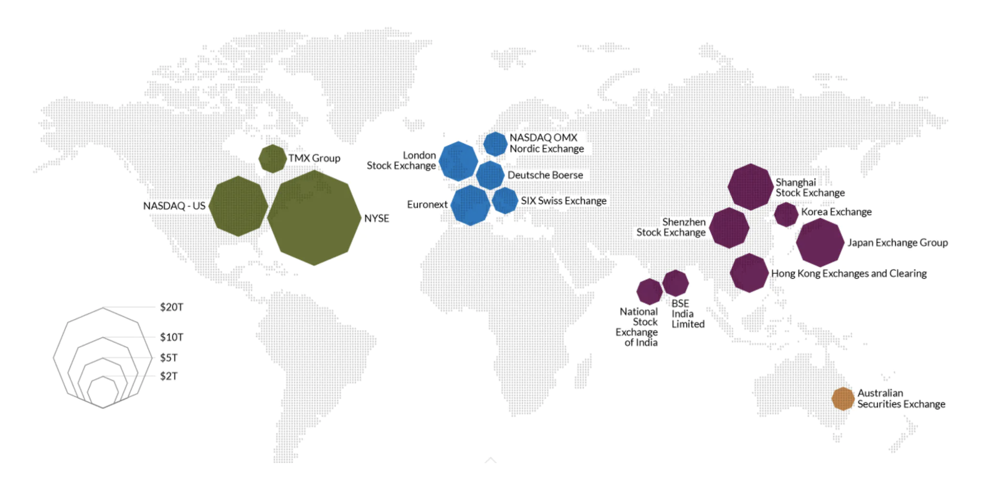
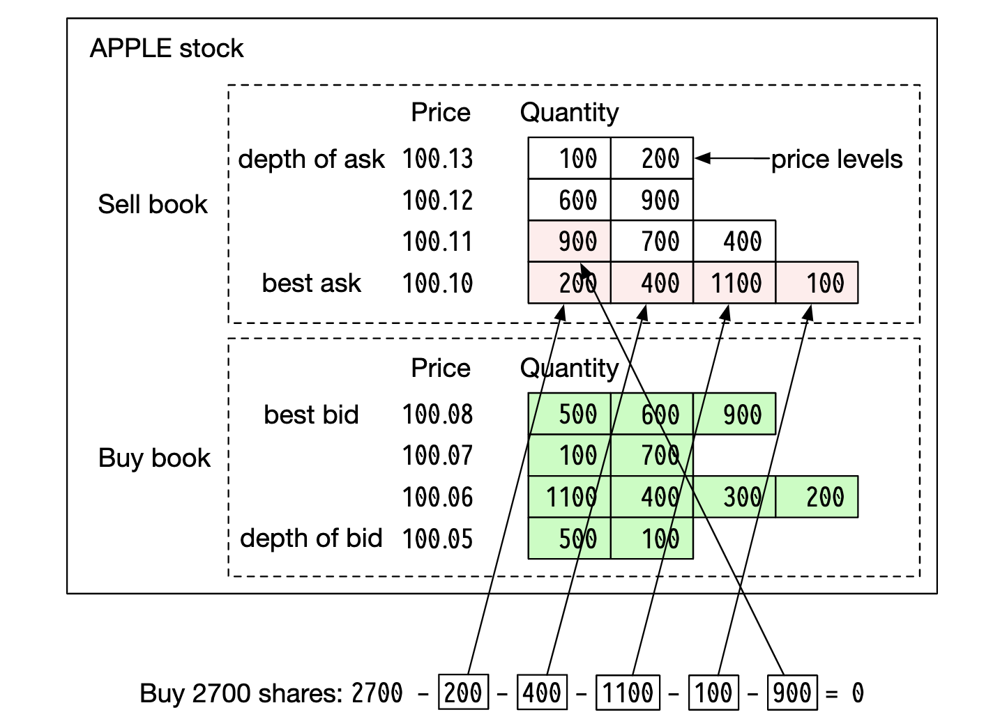
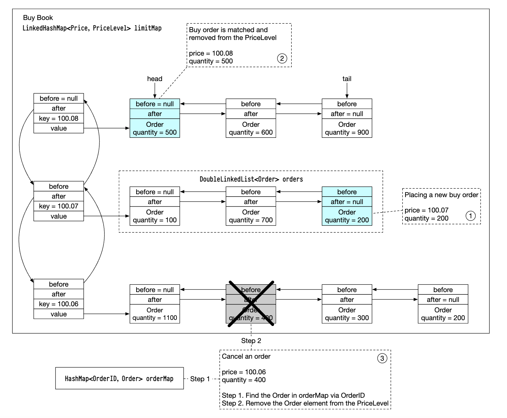
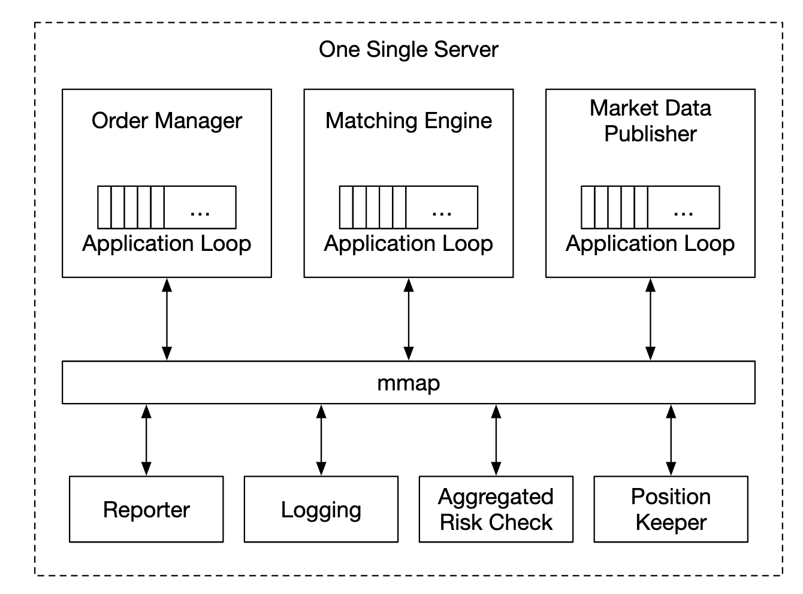
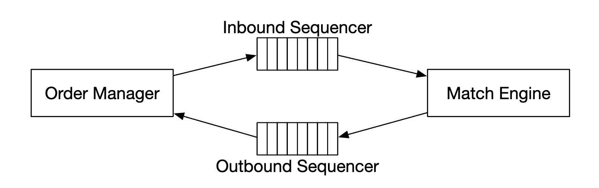

# Chapter 28: Real-time Stock Exchange Design (NASDAQ / NYSE / LMAX Architecture)

## Introduction (भूमिका)
एक **Electronic Stock Exchange** (जैसे NASDAQ, NYSE, या NSE) दुनिया का सबसे तीव्र, लेटेंसी-सेंसिटिव और मिशन-क्रिटिकल सिस्टम होता है। इसका बुनियादी काम खरीदारों (Buyers) और विक्रेताओं (Sellers) के ऑर्डर्स का अल्ट्रा-लो लेटेंसी (माइक्रोसेकंड्स) में मिलान (Order Matching) करना है।

> [!CAUTION]
> **वित्तीय ट्रेडिंग की कठोर वास्तविकता:**
> सामान्य वेब सिस्टम्स में लेटेंसी मिलीसेकंड्स (ms) में मापी जाती है, लेकिन हाई-फ़्रीक्वेंसी ट्रेडिंग (HFT) और स्टॉक एक्सचेंजेस में **1 माइक्रोसेकंड ($\mu\text{s}$) की देरी भी लाखों डॉलर का नुकसान करा सकती है**! यहाँ GC (Garbage Collection) पॉज़, नेटवर्क जिटर, या लॉक कंटेंशन बिल्कुल अस्वीकार्य हैं।

### सिस्टम की मुख्य आवश्यकताएं (Scope & Estimates)
- **100 Symbols (Stocks जैसे Apple, Microsoft, Reliance)**।
- **1 Billion Orders प्रति दिन** $\implies$ ट्रेडिंग आवर्स (6.5 घंटे) में Average QPS: 43,000, Peak QPS: **215,000 Orders / Second**!
- **Round-Trip Latency:** **< 1 मिलीसेकंड (99th percentile $< 100\,\mu\text{s}$)**।
- **Deterministic Order Matching:** FIFO (Price-Time Priority) के अनुसार हर ऑर्डर का परिणाम 100% पूर्व-निर्धारित होना चाहिए।
- **High Availability:** 99.99% Uptime (प्रति दिन 8.6 सेकंड से भी कम डाउनटाइम)।

---

## Step 1: Business Knowledge 101 — ट्रेडिंग के मूल सिद्धांत

    

1. **Limit Order vs Market Order:**
   - **Limit Order:** खरीदार या विक्रेता एक निश्चित कीमत तय करता है (जैसे *"मैं Apple 10 शेयर्स $150 पर ही खरीदूंगा"*). यह तुरंत मैच नहीं होता, ऑर्डर बुक में कतार में लग जाता है।
   - **Market Order:** कोई कीमत तय नहीं, मौजूदा बाज़ार भाव पर तुरंत एग्जीक्यूट होता है।
2. **Bid & Ask:**
   - **Bid:** उच्चतम कीमत जो कोई खरीदार देने को तैयार है।
   - **Ask:** न्यूनतम कीमत जिस पर कोई विक्रेता बेचने को तैयार है।
   - **Bid-Ask Spread:** दोनों के बीच का अंतर।
3. **L1, L2, L3 Market Data:**
   - **L1 Data:** केवल बेस्ट बिड और आस्क दिखाता है।
   - **L2 Data:** अलग-अलग प्राइस लेवल्स पर वॉल्यूम (Order Depth) दिखाता है।
   - **L3 Data:** प्रत्येक प्राइस लेवल पर खड़े व्यक्तिगत ऑर्डर्स की कतार दिखाता है।

---

## Step 2: The Heart of the Exchange — The Order Book

    

ऑर्डर बुक किसी भी शेयर के लिए खरीदारों और विक्रेताओं की सूची है, जो मूल्य के अनुसार क्रमबद्ध (Price-Time Priority) होती है।

### ऑर्डर बुक का डेटा स्ट्रक्चर ($O(1)$ ऑपरेशन्स):

    

- **Doubly-Linked List per Price Level:** एक ही कीमत पर आने वाले ऑर्डर्स को लिंक्ड लिस्ट में रखा जाता है।
  - **नया ऑर्डर जोड़ना:** पूंछ (Tail) पर $O(1)$।
  - **ऑर्डर मैच करना:** सिर (Head) से हटाना $O(1)$।
  - **ऑर्डर कैंसिल करना:** बीच से हटाना $O(1)$।
- **B-Tree / Red-Black Tree + Hash Map:** कीमतों के विभिन्न लेवल्स को सॉर्टेड रखने और $O(1)$ में किसी ऑर्डर ID को खोजने के लिए।

---

## Step 3: Extreme Low-Latency Architecture (LMAX Disruptor & Single-Server Pattern)

पारंपरिक माइक्रो-सर्विसेज आर्किटेक्चर (जहाँ 10 सर्विसेज नेटवर्क पर JSON या RPC से बात करती हैं) स्टॉक एक्सचेंज के लिए **बहुत धीमी** होती हैं (नेटवर्क हॉप ही 2-5 ms ले लेता है)!

    

### आधुनिक एक्सचेंज का गुप्त फॉर्मूला:
1. **Single-Box Monolith for Matching:** मैचिंग इंजन को कई सर्वर्स में बांटने के बजाय एक विशालकाय, अत्यधिक शक्तिशाली बेयर-मेटल सर्वर (जैसे 128 Cores, 1TB RAM) पर चलाया जाता है।
2. **Lock-Free Ring Buffer (LMAX Disruptor):** थ्रेड्स के बीच डेटा ट्रांसफर के लिए कोई Mutex Locks नहीं होते। मेमोरी पहले से प्री-एलोकेट होती है, जिससे **Zero Garbage Collection (No GC Pauses)** रहता है।
3. **Shared Memory (`/dev/shm` + `mmap`):** प्रोसेसेस के बीच संचार नेटवर्क केबल से नहीं, बल्कि रैम के अंदर **mmap System Call** से होता है (समय: 0.1 माइक्रोसेकंड!)।
4. **CPU Pinning (Thread Affinity):** मैचिंग लूप को एक डेडिकेटेड CPU कोर पर लॉक कर दिया जाता है ताकि OS कॉन्टेक्स्ट स्विचिंग का समय शून्य हो जाए।
5. **Kernel Bypass (Solarflare OpenOnload):** नेटवर्क पैकेट सीधे नेटवर्क कार्ड (NIC) से यूज़र स्पेस में आ जाता है, लिनक्स कर्नेल को बायपास करते हुए!

---

## Step 4: Determinism & Disaster Recovery (Sequencer Engine)

    

- **The Sequencer:** मैचिंग इंजन में प्रवेश करने से पहले प्रत्येक ऑर्डर को एक ग्लोबल यूनिक क्रम संख्या (`Sequence_ID = 1, 2, 3...`) दे दी जाती है।
- **Deterministic Replay:** यदि मैचिंग इंजन का सर्वर क्रैश हो जाए:
  - स्टैंडबाय सर्वर (Hot Replica) सुबह के इवेंट #1 से लेकर आखिरी इवेंट तक सारे ऑर्डर्स दोबारा 1 सेकंड में प्ले कर देता है।
  - चूंकि मैचिंग लॉजिक पूरी तरह डिटरमिनिस्टिक है, इसलिए 100% सटीक वही स्थिति (State) दोबारा बन जाती है बिना किसी विसंगति के!
- **Colocation (कोलोकेशन):** बड़े हेज फंड्स और संस्थागत ब्रोकर्स एक्सचेंज के डेटा सेंटर के उसी रैक में अपने सर्वर लगाते हैं ताकि प्रकाश की गति (Speed of Light in Fiber) के कारण उन्हें 1 माइक्रोसेकंड का अतिरिक्त फायदा मिल सके।

