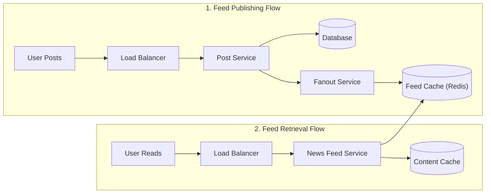

# Chapter 11: News Feed System Design करना (Facebook / Instagram / Twitter Feed)

## Introduction (भूमिका)
एक **News Feed System** किसी भी सोशल नेटवर्क (जैसे Facebook, Instagram, Twitter/X) का दिल होता है। यह यूज़र को उसके दोस्तों और फॉलो किए जाने वाले पेजों द्वारा पोस्ट किए गए स्टेटस, फोटो, वीडियो और आर्टिकल्स की लगातार अपडेट होने वाली लिस्ट दिखाता है।

इस चैप्टर में हम एक अत्यधिक स्केलेबल न्यूज़ फीड सिस्टम का आर्किटेक्चर समझेंगे।

---

## Step 1: Requirements और Scope समझना

### 1. Functional Requirements
- **Feed Publishing:** यूज़र टेक्स्ट, फोटो और वीडियो के साथ नई पोस्ट पब्लिश कर सकता है।
- **Feed Retrieval:** यूज़र जब ऐप खोले, तो उसे अपने सभी दोस्तों की हालिया पोस्ट्स **Reverse Chronological Order** (सबसे ताज़ा पोस्ट सबसे ऊपर) में दिखें।

### 2. Scale & Estimates
- **10 Million DAU** (Daily Active Users).
- प्रत्येक यूज़र के औसतन **500 से 5,000 दोस्त/फॉलोअर्स** हो सकते हैं।
- **Read-Heavy System:** यूज़र पोस्ट दिन में 1-2 बार करता है, लेकिन फीड दिन में 20-50 बार स्क्रॉल करता है (Read:Write Ratio $\approx$ 100:1).

---

## Step 2: High-Level Architecture (दो मुख्य प्रवाह)

सिस्टम को दो स्वतंत्र पाइपलाइनों में विभाजित किया जाता है:

---

## Step 3: Design Deep Dive — Fanout-on-Write vs Fanout-on-Read

इंटरव्यू का सबसे महत्वपूर्ण और केंद्रीय सवाल: **फैनआउट (Fanout) कैसे करें?**

### 1. Fanout on Write (Push Model - प्री-कंप्यूटेशन)
- जब कोई यूज़र पोस्ट करता है, तो बैकएंड तुरंत उसके सभी 1,000 दोस्तों की व्यक्तिगत **News Feed Cache (Redis In-Memory List)** में उस पोस्ट की ID पुश कर देता है।
- **Pros (फायदे):** 
  - रीड लेटेंसी लगभग शून्य होती है ($O(1)$)। यूज़र जैसे ही ऐप खोलता है, उसकी फीड पहले से तैयार (Pre-computed) मिलती है।
- **Cons (कमियां - The Celebrity / Hotkey Problem):** 
  - यदि क्रिस्टियानो रोनाल्डो या नरेंद्र मोदी (100 Million+ फॉलोअर्स) कोई पोस्ट करते हैं, तो 1 पोस्ट के कारण बैकएंड को 100 Million इन-मेमोरी राइट्स एक साथ करने पड़ेंगे। इससे सर्वर कतारें चोक हो जाएंगी।

---

### 2. Fanout on Read (Pull Model - ऑन-डिमांड)
- पोस्ट करते समय केवल पोस्ट डेटाबेस में सेव होती है। दोस्तों की इनबॉक्स में कुछ पुश नहीं होता।
- जब कोई दोस्त ऐप खोलता है, तब रन-टाइम पर उसके सभी 500 दोस्तों की हालिया पोस्ट्स क्वेरी की जाती हैं और टाइमस्टैम्प से सॉर्ट की जाती हैं।
- **Pros:** कोई राइट स्पाइक नहीं। इनएक्टिव यूज़र्स के लिए रिसोर्स बर्बाद नहीं होते।
- **Cons:** रीड लेटेंसी बहुत ज्यादा बढ़ जाती है ($O(N \log N)$), जिससे ऐप धीमी लोड होती है।

---

### 3. The Winner: Hybrid Fanout Architecture (सर्वश्रेष्ठ हाइब्रिड मॉडल)
Facebook और Twitter दोनों हाइब्रिड मॉडल का उपयोग करते हैं:
1. **सामान्य यूज़र्स (Ordinary Users):** **Push Model** इस्तेमाल करें (क्योंकि 99% यूज़र्स के 1,000 से कम दोस्त होते हैं, जो Redis में तुरंत पुश हो जाते हैं)।
2. **सेलिब्रिटी / इन्फ्लुएंसर्स (Celebrities > 50,000 Followers):** **Pull Model** इस्तेमाल करें। उनकी पोस्ट्स को करोड़ों फॉलोअर्स की फीड में पुश नहीं किया जाता।
3. जब कोई आम यूज़र अपनी फीड लोड करता है:
   - उसका तैयार फीड कैश (Push Feed) पढ़ा जाता है।
   - उसके द्वारा फॉलो किए जाने वाले सेलिब्रिटीज़ की ताज़ा पोस्ट्स (Pull Feed) ऑन-द-फ्लाई मर्ज कर दी जाती हैं।

---

## Step 4: 5-Tier Cache Architecture (मल्टी-लेयर कैशिंग)

मेमोरी बचाने के लिए फीड कैश में पूरा पोस्ट ऑब्जेक्ट (Text, Author, Image URLs) नहीं रखा जाता। इसके बजाय 5 कैश लेयर्स बनाई जाती हैं:
1. **News Feed Cache:** केवल `[Post_ID, Timestamp]` की सॉर्टेड लिस्ट रखता है।
2. **Content Cache:** `post_id -> {text, media_urls}` का डेटा स्टोर करता है।
3. **Social Graph Cache:** फॉलोअर्स और दोस्तों की लिस्ट रखता है।
4. **Action Cache:** लाइक्स, शेयर्स और कमेंट्स की ताज़ा स्थिति रखता है।
5. **Counter Cache:** कुल लाइक्स और व्यूज के इन-मेमोरी काउंटर्स रखता है।

---

## इंटरव्यू समरी (Interview Key Points)
- **Hybrid Fanout** सेलिब्रिटी हॉटकी समस्या और लो-लेटेंसी रीड्स दोनों को एक साथ हल करता है।
- Redis Lists या Sorted Sets (`ZADD / ZREVRANGE`) का उपयोग करके प्रत्येक एक्टिव यूज़र की फीड के केवल टॉप 500 पोस्ट IDs कैश में रखे जाते हैं, जिससे मेमोरी की भारी बचत होती है।
